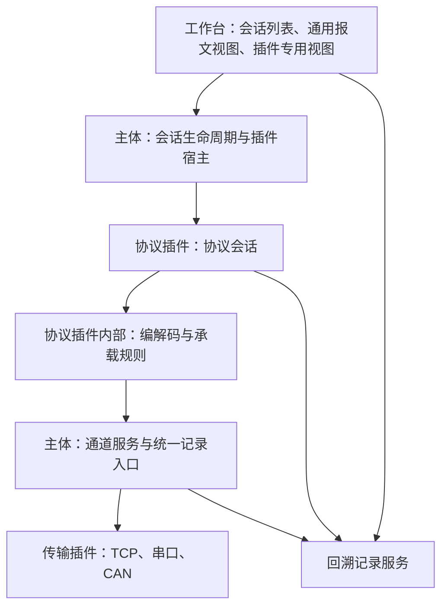

# 多协议调试工具架构基线

Status: needs-triage

当前产品规格见 [正式规格](spec.md)（ready-for-agent）。开发使用 VS Code + CMake，按本机安装采用 Qt 6.12.0 / LLVM-MinGW Clang 22.1.7 / C++17，见 [环境核验](toolchain-environment.md)；以调试会话公开接口作为主要测试入口。本文的技术草案状态与正式规格的分诊状态分别管理。

Q36 已于 2026-10-22 确认本通用架构基线。一个会话管理一个端点、一种协议及其多个设备；仅读取按会话配置重试，设备写入不自动重试；状态与恢复以人工调试为主；首版采用 Windows x64、Qt 6、CMake 和 Qt Widgets。实施顺序为 RTU → UPP/CAN → TCP，记录采用通信优先与本地有界缓存。接口实现提案见 [接口契约](interface-contracts.md)，具体任务见 [实施 issue 索引](implementation-plan.md)。产品取舍已确认，候选 C++ 类型、依赖版本和性能值仍须验证。

## 已确认的架构基线

- 标准协议和自定义协议均通过插件接入，不修改主体，暂不提供协议编辑器。
- Modbus 与 UPP 各自组包、处理协议交互，共用传输与记录。
- 协议和传输插件在应用启动时发现并加载，更新后重启；按配套 SDK 与构建版本交付。
- 插件缺失、不兼容或加载失败只禁用依赖它的功能/会话，保留配置并提示原因；修复插件并重启后恢复使用。
- 首版支持 Modbus TCP/RTU 主从及 UPP/CAN 的一组真实消息收发解析。
- 支持多个会话同时运行。默认近期记录有容量上限，支持导出和用户开启的磁盘记录。
- 通信优先，进程内有界缓存、后台批量记录、界面批量刷新；记录溢出明确提示。Redis 留作实测后可选后端，首版不依赖 Redis。
- 一个会话管理一个通信端点，使用一种协议，支持该协议下的多个设备；首版不做同端口多协议。
- 插件负责协议交互、配置/操作声明及专用视图，主体负责生命周期、通道、记录及通用界面。
- 原始记录、协议消息和调试操作分别建模并关联；仅读取支持自动重试，次数和时间在会话级配置，设备写入/参数设置不自动重试。
- Modbus 按已确认的四类数据区及八个常用功能码实现，主站观测值与从站模拟数据分别保存。
- 一个 JSON 从站数据文件对应一个 Modbus 从站设备，支持校验后整体导入、编辑、保存及另存为；JSON 字段允许按设计需要扩展。
- 从站改值立即影响运行数据，显式保存负责持久化；从站启动依赖外部 JSON，工作区保存文件引用，文件缺失时不启动。
- 首版界面使用 Qt Widgets；后续绘图面板可按需用 QQuickWidget 嵌入 QML。
- 首版发布基线为 Windows x64、Qt 6.12.0、LLVM-MinGW Clang 22.1.7、C++17、CMake 3.30.5 和 Ninja 1.12.1，开发使用 VS Code。支持保存工作区，打开工作区后由操作人员启动通信。
- 状态展示保持简单，提供必要的连接状态、操作结果和错误原因。断线后可选自动重连并恢复轮询，未确认的写入交由操作人员处理。
- UPP 规范稍后提供，具体线格式、路由、分片和交互语义暂不设计。

## 职责划分（Q12 已确认，具体 SDK 细节待定）

| 模块 | 责任 | 对外边界 |
| --- | --- | --- |
| 工作台 | 通用概要、会话操作、回溯入口、插件视图容器 | 调用会话操作，读取视图模型与记录 |
| 插件宿主 | 发现、版本校验、能力查询、创建插件实例 | 通过声明和工厂识别插件，不按协议名称分支 |
| 会话宿主 | 启停、资源申请、状态与事件分发、计时服务 | 提供生命周期和通用运行服务 |
| 协议会话 | 角色行为、操作验证、轮询、请求关联、重试策略、从站数据 | 将用户操作转为协议交互，将通信结果转为结构化事件 |
| 编解码与承载模块 | 字段编解码、组帧/拆帧、校验、传输映射 | 属于协议插件内部；允许复用库，不强制每种协议拆出相同子类 |
| 通道服务 | 管理资源占用、端点/连接、发送队列、统一原始记录入口 | 协议插件申请端点并收发，不自行打开串口或 socket |
| 传输插件 | 设备或网络连接、原始数据收发、传输状态和能力 | 保留流/帧/数据报边界及传输元数据，不解释协议 |
| 回溯服务 | 有界近期记录、可选磁盘记录、关联查询与导出 | 同时接纳原始记录、协议结果、诊断和状态事件 |

协议插件声明配置项、操作和可选专用视图；身份、兼容版本、角色及支持组合是后续 SDK 声明设计的基础。通用配置表单来自插件提供的描述，用户使用这些表单配置连接和操作；这不等于允许用户定义新协议。专用视图通过扩展点挂载，Modbus 寄存器视图归 Modbus 插件，不把寄存器模型强加给 UPP。见 [ADR 0004](../../docs/adr/0004-protocol-owned-interaction-and-views.md)。

主体保持稳定的承诺建立在已发布 SDK 能力范围内。协议专用行为、字段和视图通过扩展点提供；如出现 SDK 没有表达能力的新需求，应显式演进接口版本，不以未文档化的特殊分支补洞。

## 端点与会话关系（Q13/Q18/Q19 已确认）

- 每个会话绑定一个配置端点；端点可以是串口、CAN 通道、TCP 主动连接或 TCP 监听端点。
- 端点由一个会话拥有；资源管理器检查冲突，避免会话各自重复打开同一设备或监听地址。
- TCP 监听端点接受多个连接，每个连接拥有独立身份、连接代次和接收缓冲。重连产生新代次，旧事务不与新连接串联。
- 一个会话可以访问或模拟多个设备地址。Modbus RTU 主站在同一总线统一排队，而非为每个地址独立并发发送。
- 每个端口会话使用一个协议实例，该实例管理协议内的多个目标设备或模拟设备。首版不包含多协议同时收发、多个解析器竞争或运行中协议切换的要求。
- 多会话同时运行不等于相同物理通道可以同时承担互相冲突的角色。

多设备表示协议内的寻址和数据隔离，不等于多种协议。设备标识由协议插件解释；Modbus 可以使用 Unit ID，UPP 的具体寻址方式等待规范。当前保留调试会话与协议实例的职责边界，但不实现多协议实例集合及分发器。

Q19 已确认映射：RTU 串口会话管理多个从站地址；TCP 主站会话绑定一个远端 IP:port，可访问其暴露的多个 Unit ID；不同远端 IP:port 分别创建会话；TCP 从站会话拥有一个监听端点，向多个客户端提供配置的多个 Unit ID。UPP 的设备地址依真实规范定义。

## 通信与回溯模型（Q14/Q26 已确认，存储实现细节待定）

| 对象 | 表达的事实 | 关联方式 |
| --- | --- | --- |
| TransportUnit | 后端交付的字节块、有边界帧或数据报 | 带端点、连接、方向、时间和按传输定义的元数据 |
| TraceRecord | 实际观测到的原始数据，或一次发送/状态/诊断事件 | 稳定记录 ID；提交发送与完成状态以关联事件表达 |
| Message | 一条已识别的协议消息及其字段、解析状态 | 引用来源记录，必要时包含字节区间；允许关联多条记录 |
| Operation | 用户发起的一次读写/发送等操作及其进展 | 关联请求、响应、重试尝试和诊断；被动报文不强制归属操作 |

- 接收数据在进入协议解析前经过统一记录入口。解析失败、未识别数据和后端可报告的错误仍可回溯。
- 一次 TCP/串口读取可能包含半条或多条协议消息；同一消息也可能跨多个读取块。消息与记录采用多对多关联及字节区间。
- 通用 Message 不增加 CAN 专属字段；界面可沿记录引用展示原始 CAN ID、标志等信息。
- 时间信息区分主机观测时间、用于间隔计算的单调时钟及可选硬件时间戳，不混用不同时钟域，不虚构后端未提供的精度。
- 发送尝试不是已上线路径的证据。记录要能区分提交、部分进展、后端报告完成、失败和协议应答。
- 当源记录已过期时保留明确的不可回溯标记；持久记录与近期缓存分别执行容量和生命周期策略。
- UPP 是否跨多个 CAN 帧仍未知。模型允许多条来源关联，但不会据此发明 UPP 分片规则。

Q26 已确认近期缓存与磁盘记录分别设置容量上限，达到容量后淘汰最旧记录或轮换文件，并提示保留范围与过期情况。磁盘记录仍由用户主动开启。容量默认值、文件分段大小与吞吐目标在验证阶段确定。

导出支持 CSV 概要和 JSONL 完整记录。JSONL 保留所选范围内可用的原始字节、传输元数据、消息/操作及其关联信息；源记录已过期时明确标识，不能声称已导出缺失的原始内容。此处 JSONL 用于通信回溯，Q25 的 JSON 用于可编辑设备数据。

## 操作、读取重试与简单恢复（Q20/Q21/Q24 已确认）

界面只呈现必要的连接状态、操作结果和可读错误原因；详细发送进展、请求关联和各次尝试留在回溯记录中。下表说明记录中的事实含义，不要求界面为每一项增加单独状态，也不要求引入复杂状态机框架。操作结果与传输发送结果仍需区别，不能将 `bool send()` 的成功显示为对端执行成功。

| 事件 | 可以向用户表达的事实 |
| --- | --- |
| 发送请求被接受 | 已进入本地处理/发送流程 |
| 后端报告发送进展或完成 | 已达到该后端定义并声明的提交阶段 |
| 正常协议应答 | 已收到并验证符合该操作的正常响应 |
| 异常协议应答 | 已收到协议层拒绝或错误 |
| 等待应答超时 | 在期限内未获得确认，对端是否执行可能未知 |
| 无应答交互完成 | 按协议完成本地发送及所需等待，不表示对端确认执行 |

仅读取操作支持自动重试，设备写入和参数设置不自动重试。次数与时间统一在会话中配置，不提供设备级覆盖；用户已明确这一选择替代此前“读写均可重试”的方案，见 [ADR 0007](../../docs/adr/0007-session-read-retries-and-operator-recovery.md)。用户手动再次发起写入属于一次新的调试操作。

Q24 已确认会话初始配置：额外读取重试 2 次、单次应答超时 1000 ms、重试间隔 100 ms，均可修改。重试次数不包含首次发送，配置 2 次即最多尝试 3 次，配置 0 次表示不自动重试；轮询周期独立配置。这些是可调整的初始值，不是设备响应能力承诺。每次尝试关联原始记录，不把多次发送折叠成一次；完成一次发送中的部分写入处理不属于重复发起应用层写操作。

协议插件识别读取操作、判断是否需要应答并关联回复，主体提供计时及记录。UPP 尚无规范，不能擅自将未知命令认定为可自动重试的读取。协议和传输的必要状态保留在对应模块内，不要求操作人员理解底层状态组合。

断线时结束当前未完成操作，保留已提交但未确认的结果和错误原因；允许配置自动重连，重连成功后恢复已有轮询。重连不补发未确认写入，操作人员决定是否再次执行。停止会话后不继续执行遗留队列，重新启动以当前配置发起新操作；迟到数据保留记录，不将旧连接结果归入新操作。

## 工作区保存与外部数据加载（Q22/Q30/Q32 已确认）

工作区保存会话、设备、轮询、会话通信/重试配置、布局和外部从站数据文件的引用。一个文件对应一个模拟从站，数据区、地址范围和数值由该 JSON 提供；工作区不再承担可供替代该文件的内嵌数据副本。实际通信日志按近期缓存、导出和可选磁盘记录的既定策略管理。

打开工作区先恢复配置，由操作人员启动通信；从站启动时加载所引用的外部 JSON。文件缺失时不启动从站通信，不回退到内嵌快照或默认零值。此选择替代 Q22 的可选快照安排与 Q30 的内嵌建议，见 [ADR 0008](../../docs/adr/0008-external-slave-data-files.md)。

一个会话内所有必需数据文件通过校验后才启动通信。任一文件缺失、无法读取或格式错误时，提示具体设备、路径与原因，并阻止该会话启动；软件界面和其他会话仍可使用。只在启动会话或主动导入时读取 JSON，运行中的外部修改或删除不会自动改变已加载数据；下次启动重新加载和校验。重新加载前存在未保存修改时，提示保存、放弃或取消。路径表示属于后续文件格式设计；插件缺失或不兼容沿用 Q33 的禁用并保留配置规则。

## Modbus 数据模型和首版操作（Q16/Q27 已确认）

- 主站的观测值/请求状态与从站的模拟数据分开保存，避免同时运行时数据互相覆盖。
- 从站按 Unit ID 维护独立数据区：线圈、离散输入、保持寄存器和输入寄存器。相同从站模拟实例对多个 TCP 客户端提供一致的数据视图，写入按该实例的执行顺序应用。
- 首版功能码为十六进制 `01/02/03/04/05/06/0F/10`，覆盖四类数据读取和线圈/保持寄存器的单个、批量写入，以及相应异常响应。
- 内部使用数据区与从 0 开始的 PDU 地址，界面明确标识地址格式；位数据使用布尔值，寄存器使用 16 位原值。从站地址范围和数值可通过数据文件配置与编辑。
- 40001 等参考编号、复杂字序/类型解读和故障注入目前未纳入已确认范围；广播交互依协议规则在实现设计中说明。

### JSON 导入、编辑与保存（Q25/Q27/Q28 已确认）

用户要求通过 JSON 导入 Modbus 数据，导入后可以在界面继续修改，并提供保存按钮。该功能归 Modbus 插件的数据视图与数据管理，不要求主体识别 Modbus 的四类数据区，也不扩展成协议编辑器。

工作区保存调试环境配置及外部文件引用；从站数据文件保存一个模拟从站的数据，并作为该从站启动时的数据来源。

已确认规则：

- 首版一个 JSON 描述一个从站设备，包含四类数据区、从 0 开始的地址范围和数值；位数据为布尔值，寄存器为 16 位原值。多设备和连接配置通过工作区保存。主站数据项的 JSON 导入暂不纳入本轮已确认范围。
- 导入先校验，再整体替换目标数据；失败保留原数据，有未保存修改先提示，首版不实现自动合并。
- 保存将当前编辑数据写回当前 JSON；新建数据首次保存选择路径，另存为用于保留不同文件。文件保存与向真实设备发起写入分别操作。
- 用户允许 JSON 字段在设计过程中按需扩展。字段的解析、校验与展示由 Modbus 插件负责，主体通过既定插件能力接入；不将当前描述当作冻结的字段清单。

字段名、可选描述信息和格式版本约定属于后续文件格式设计，当前不为其新增逐字段确认流程。字段扩展仍应保持单设备数据文件与既定协议语义的边界。

### 运行时数据与文件保存（Q29–Q32 已确认）

- 运行中提交有效的值修改后立即更新从站模拟数据，后续协议请求使用更新后的值，不需要先点击保存。
- 保存把当前数据写回 JSON，另存为可保留不同文件；对运行数据的修改与写入磁盘是两个动作。下次启动以外部 JSON 为数据来源。
- 当前“立即生效”按从站模拟数据讨论，不据此将主站观测缓存的编辑直接当作真实设备已成功写入。

- 整份 JSON 导入及地址范围调整也在校验成功后立即用于后续请求，无须停止会话。一次请求使用一致的数据视图，避免替换过程中读到半份配置；失败保留原数据。
- 启动会话或用户主动导入时读取文件，运行中外部文件变化不自动影响已加载数据；下次启动重新加载和校验。重新加载前有未保存修改时沿用保存、放弃或取消提示。
- 会话内必需文件全部校验成功后才启动通信；缺失、无法读取或格式错误阻止该会话启动，提示设备、路径和原因，软件界面及其余会话仍可用。

文件解析与数据管理仍归 Modbus 插件，主体管理会话启动和结果提示，不直接解释 Modbus 数据区。立即生效的替换边界位于协议请求之间，不要求引入复杂的用户状态或暂停流程。

## 界面、平台与执行模型（Q17 界面选择已确认）

首版选择 Windows x64、Qt 6、CMake 和 Qt Widgets；后续绘图面板可使用 QQuickWidget 嵌入 QML，见 [ADR 0006](../../docs/adr/0006-widgets-shell-with-optional-qml-panels.md) 与 [界面工具包对比](ui-toolkit-comparison.md)。Qt/编译器已按本机安装固定，详见 [环境选型](toolchain-environment.md)。

视图接口按以下边界细化：可选视图工厂返回 QWidget 容器，普通 Widgets 面板和包含 QQuickWidget 的绘图面板以相同方式挂载。协议核心与可选视图工厂接口分离；界面经展示模型和操作入口访问会话，不直接调用串口/socket。所有 QWidget/QQuickWidget 及 GUI 模型在 GUI 线程管理，后台数据以排队事件更新展示模型。

模型的 C++/QML 所有权需明确。若使用共享 QQmlEngine，先销毁相关视图，再销毁引擎；引用插件代码的对象销毁前，插件保持加载。后续绘图面板需要验证点数、刷新率与离屏渲染成本；首版不为未来绘图预先创建 QML 引擎。

执行模型的候选约束：GUI 对象只在 GUI 线程访问；I/O 和协议状态在其所属执行上下文中串行更新；磁盘写入与界面渲染不阻塞通信事件处理。不预先承诺每个会话一个线程，待并发和吞吐目标明确后确定线程数、队列上限及背压策略。

## SDK 接口形状（概念草案）

| 接口 | 输入与输出 | 待细化内容 |
| --- | --- | --- |
| ProtocolPlugin | 声明能力；创建协议会话，按能力提供可选视图工厂 | 版本、错误和所有权规则 |
| ProtocolViewFactory | 在 GUI 线程创建 QWidget 视图容器，可内部使用 QQuickWidget | 展示模型、操作入口、销毁顺序、QML 资源交付 |
| ProtocolSession | 接受操作、接收数据和运行事件；发出消息、操作结果和发送意图 | 计时、取消、序列化运行和事件顺序 |
| TransportPlugin | 声明传输能力；创建配置端点 | 资源标识、连接模式、能力/必需字段校验 |
| Channel | 异步打开、发送和关闭；发出连接、原始数据和发送结果 | 发送 ID、连接身份、有限队列、关闭时未完成操作 |
| TraceQuery | 根据消息、操作或时间范围读取相关记录，导出 CSV 概要或 JSONL 完整记录 | 记录字段、过期标识、磁盘轮换与索引 |

原始 `feed(bytes, meta)` 不能独自表达 RTU 静默时间事件；`encode()` 返回一组发送单元也不必意味着全部立即发送。建议由协议会话响应时间、连接和发送事件，按协议规则驱动编解码和逐步发送；无需为尚未知晓的 UPP 定义固定分片方案。

## 架构收束与分阶段验证

### 插件加载失败（Q33 已确认）

插件缺失、不兼容或加载失败时，仅禁用依赖该插件的功能和会话并提示原因，保留工作区中的插件身份和原始配置。修复插件并重启后可继续使用；保存工作区不能顺带清除暂时无法解释的配置。兼容声明与加载结果由插件宿主管理，各协议遵循同一契约。

### 记录跟不上通信与 Redis 候选（Q34/Q36 已确认）

Q36 明确优先保持通信，首版采用进程内有界缓存、后台批量记录和界面批量刷新。磁盘或记录处理持续落后时，通信继续运行，队列溢出导致的记录丢失以计数和时间范围明确提示。收到过但来不及记录的数据不能伪装成完整历史，关联查询沿用不可回溯标记。已保存历史达到保留容量时的轮换沿用 Q26，分别显示丢失与正常过期。见 [ADR 0009](../../docs/adr/0009-communication-first-bounded-recording.md)。

Redis 可作为后续可选记录后端，尤其在独立记录进程或多个工具共享记录时值得对照验证。官方资料显示其客户端/服务端交互存在往返成本，Windows 部署需要额外服务环境；持续输入速度超过消费速度时，有限缓存仍会积压。因此不预设 Redis 比进程内缓存更快，也不把 Redis 安装列为首版前置条件。事实、来源与设计推论见 [缓存评估](recording-cache-options.md)。

回溯模块内部将记录写入与存储实现分离；本地文件与以后可能采用的 Redis 从后台写入接口接入，协议/传输插件和 GUI 不同步等待后端。首版不为此增加一套存储插件 SDK。队列大小、刷新周期和可持续吞吐通过原型测量确定，不把初始配置当作性能承诺。

### 验证顺序与关键验收（Q35 已调整）

用户确定顺序为 Modbus RTU → UPP/CAN → Modbus TCP：

1. 先随 RTU 主从实现公共宿主、串口传输、统一记录、协议交互和必要界面，验证一会话多设备、JSON 数据与读写行为。同一物理 RTU 总线保持一个主站；主从联调使用分别拥有端口的端点或独立设备。
2. 依据真实 UPP 规范完成 CAN 消息收发与解析，验证自定义协议插件接入时主体代码保持稳定。规范到位前只细化通用接口，不编造 UPP 字段或交互规则。
3. 最后添加 TCP 传输及 Modbus TCP 主从，在 Modbus 插件内复用适用的 PDU/数据模型，并验证连接与多客户端相关行为。

TCP 不作为 RTU 阶段的前置工作；通用架构收束不代表 UPP 线格式和真实硬件验证已完成。

后续验证计划应覆盖：

- RTU 的串口占用、总线调度、时序/校验与标准功能码行为；使用规范样例和独立参考实现交叉验证，不能只依靠本工具两端互通。
- UPP/CAN 的真实消息闭环及插件接入边界，具体测试数据依用户后续提供的协议规范确定。
- TCP 阶段验证流拆分/粘连、按连接关联请求、同一会话多个 Unit ID、多个客户端访问共享从站数据。
- 读取按会话配置重试，设备写入不自动重试，断线不补发未确认写入。
- JSON 校验失败不替换运行数据，合法替换对后续请求生效；启动缺文件只阻止对应会话，外部文件运行中变化不触发自动重载。
- 原始记录与消息/操作的关联、过期提示、CSV/JSONL 导出，以及过载丢失提示。
- 新增协议插件后主体代码保持不变，新插件能使用统一传输/记录并挂载必要配置、操作和视图；验证插件加载失败与配置保留。

本节记录已确认的阶段顺序和验证重点，实施由独立 issue 跟踪。

## 已核验的协议与平台事实

- RTU 帧间与帧内静默时间影响成帧；同一串行总线一个主站统一管理在途事务；地址 0 广播没有响应。[Modbus 串行规范 V1.02](https://www.modbus.org/file/secure/modbusoverserial.pdf)
- Modbus TCP 使用 MBAP 长度恢复报文边界，Transaction ID 在连接内关联请求和响应。[Modbus TCP 实施指南](https://www.modbus.org/file/secure/messagingimplementationguide.pdf)
- 四类数据区、上述功能码和从 0 开始的 PDU 地址由应用协议定义。写响应在写入后返回，因此“响应超时不证明未写入”属于由此得到的设计推论。[Modbus 应用协议 V1.1b3](https://www.modbus.org/file/secure/modbusprotocolspecification.pdf)
- Qt 串口采用独占访问；TCP 服务端每个连接有独立 socket；事件驱动对象与 GUI 有线程归属要求。[QSerialPort](https://doc.qt.io/qt-6/qserialport.html)、[QTcpServer](https://doc.qt.io/qt-6/qtcpserver.html)、[Threads and QObjects](https://doc.qt.io/qt-6/threads-qobject.html)

## 暂缓与后续

- UPP 线格式和真实消息验收：等待用户后续提供规范，不阻塞上述宿主架构讨论。
- 通用架构已由 Q36 确认；后续以接口契约及 issue 评审、验证结果推进，不再重复访谈已确认的产品取舍。
- 后续技术设计与核验：插件接口版本和生命周期、实现组件选型、文件格式和记录字段、原型测量后的容量/性能/时序目标，以及磁盘轮换实现。
- [实施 issue 索引](implementation-plan.md) 已发布用户确认的 19 项功能切片，标注直接依赖和默认分诊状态。工具链已验证，先从会话启停的 01 开始，02 承接 Modbus 实现选型；UPP 相关 14/15 等待协议资料。ready-for-agent 仍需满足前置，不能视作已经完成。
