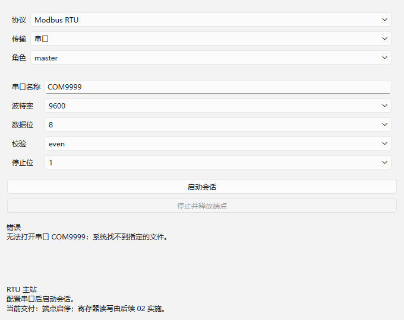
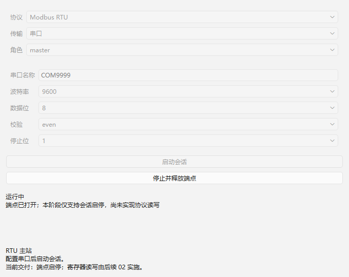
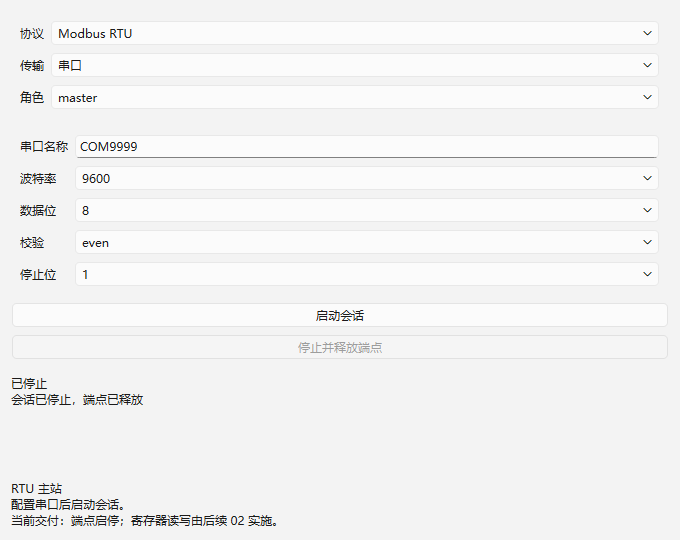

# 01：RTU 会话生命周期验收证据

日期：2026-10-22（Asia/Shanghai）。范围：[01](../../issues/01-rtu-session-lifecycle.md)，依据正式规格、当前实施索引、AGENTS、领域术语、ADR 0001–0009、架构及接口契约草案。仅实现单个主站会话启停；没有实现 02 的 Modbus 报文读写。

## 环境与复现

Windows 11 x64；复用既有 Qt 6.12.0 `llvm-mingw_64`、LLVM-MinGW Clang 22.1.7、C++17、CMake 3.30.5、Ninja 1.12.1。Qt 自身为 release 构建，产品分别使用 Debug/Release，所有插件与宿主使用对应的同套编译配置。没有安装工具或改全局 PATH。

```powershell
./scripts/verify.ps1
./scripts/run.ps1
```

验证脚本逐项检查退出码并保存日志；配置预设设置子进程 Qt/LLVM DLL 路径。界面测试通过 `QT_QPA_PLATFORM=windows` 在原生 Widgets 上执行按钮、编辑框和状态检查；截图由实际测试窗口 `grab()` 生成。可选 Vulkan headers 未找到的配置提示与既有工具链验证一致，当前 Widgets 构建成功。

| 检查 | Debug | Release |
| --- | --- | --- |
| CMake 配置 | [通过](qt-llvm-debug/configure.log) | [通过](qt-llvm-release/configure.log) |
| 产品与 DLL 构建 | [通过](qt-llvm-debug/build.log) | [通过](qt-llvm-release/build.log) |
| CTest | [1/1 通过](qt-llvm-debug/ctest.log) | [1/1 通过](qt-llvm-release/ctest.log) |
| Qt Test | [13 passed / 0 failed / 0 skipped](qt-llvm-debug/test-results.txt) | [13 passed / 0 failed / 0 skipped](qt-llvm-release/test-results.txt) |

13 项计数包括初始化/清理两个检查，实际行为测试 11 项。产物及截图的 SHA-256 见 [Debug](qt-llvm-debug/sha256.txt) 和 [Release](qt-llvm-release/sha256.txt)；可执行文件/DLL 在忽略的 `build/<preset>/bin`，源码与证据一同提交。

## 验收映射

| 条件 | 外部行为证据 |
| --- | --- |
| 最小产品与真实插件 | CMake 构建 EXE、协议 DLL、传输 DLL；`initTestCase` 从 bin/plugins 发现两个真实插件；`pluginViewLifetime` 创建插件定义的 QWidget 子类、销毁并验证注册表租约释放 |
| 支持组合与参数 | `rejectsUnsupportedAndInvalid` 通过会话公开 start 拒绝未声明角色、缺失传输、非法波特率及端口，保留输入配置 |
| 占用与释放 | `startStopAndRelease` 验证 COM9999 与 `\\.\com9999` 为同一端点；占用失败给出原因，停止后另一会话可打开 |
| 失败清理与重启 | `failureReleasesAndRetry` 覆盖异步打开失败、再次启动、运行中错误、释放后再申请 |
| 旧回调隔离 | `staleCallbacksAndDestruction` 覆盖停止前排队的成功、停止后迟到失败、重启后的旧结果及销毁后事件，不改变新运行 |
| 通知重入 | `stopOrDestroyFromStartingNotification` 在 Starting 通知中同步停止或销毁会话，资源释放且另一会话可复用 |
| 兼容与坏插件隔离 | `brokenPluginDoesNotHideWorkingOnes` / `incompatibleAndDuplicatePlugins` 验证损坏 DLL、不同 SDK/构建指纹及重复 ID 被诊断，可用插件继续存在 |
| 实际串口失败路径 | `realSerialOpenError` 经过真实 serial DLL 和 QSerialPort，COM9999 打开失败并给出端口及系统原因，再次启动仍可正常报告错误 |
| 界面流程 | `widgetFlow` 验证真实串口打开错误可见、配置可重试；`widgetStartStopWithControlledTransport` 验证打开中禁用配置、成功状态、停止按钮释放和恢复编辑 |

通道测试注入在 DebugSession 的 EndpointFactory 边界，使用真实协议插件、注册表、配置校验和端点占用管理；没有将测试 Adapter 注册成产品协议或支持组合。当前 SDK 仅声明会话生命周期和串口字节流所需能力，没有伪造尚未实现的操作/发送/计时 API。

## 界面证据

以下为 Debug 截图，Release 同名截图也已保存。

真实串口 DLL 打开不存在的 COM9999：



可控传输报告成功后的运行状态（不是硬件连接证据）：



点击停止后释放端点、恢复配置：



## 审查

使用 `code-review` 技能，以 Standards / Spec 两个子代理独立审查。仓库原来没有任何提交，故将技能的固定基线适配为空树，检查 `git diff --cached` 的本次新增实现；修复后复核工作树。未为此创建空的基线提交。

| 轴 | 初审 | 修复与最终结论 |
| --- | --- | --- |
| Standards | 无项目约定违规或需改动的代码异味；发现一处启动通知重入生命周期错误 | 打开端点后再发 changed，通知后不再访问成员；新增同步停止/销毁回归，复核关闭 |
| Spec | 同一处问题违反“停止后端点可重新使用，旧回调不改变新运行” | 同上；未发现其他缺失或越界，最终无剩余问题 |

两轴初审各 1 个发现（同一根因），最终各 0 个未解决发现。修复后 Debug/Release 全部测试重新通过。提交前对代码和文档运行 `git diff --cached --check`，排除直接捕获的 `*.log`；原始 CMake/CTest 日志保留工具自身输出的行尾空格。

## 未覆盖条件与过程记录

- 本机枚举到 1 个串口，未取得独立对端和拓扑条件；没有打开现有实际设备。真实串口成功打开、外部占用成功冲突、硬件收发、RTU 静默时间、断线时序与独立对端互通尚未验证。本项以真实后端失败路径和可控传输生命周期验收，不替代 13 的硬件阶段验收。
- Modbus 协议插件目前只提供主站启停和专用说明视图，运行状态仅表示端点打开，不代表设备应答。组件选型、CRC、功能码、收发、重试、从站和工作区均留给后续任务。
- 初始 offscreen 截图缺少字体，故改用 Windows 平台重新生成并检查中文；交付的截图均为修正后的原生界面。
- 曾增加“销毁注册表后立即删除复制的 DLL 文件”的临时目录检查，Windows 上映像仍被保留而失败。这不是本项的对象销毁契约，且运行中卸载不在规格范围。测试夹具改为构建目录中的持久 DLL；仍验证视图/会话销毁、租约释放及端点释放，不声称支持热卸载。临时失败日志未替代最终通过的日志。
- 原有规格、工具链核验和其他任务文件在本次开始前均未纳入 Git。提交仅纳入本次产品实现、01 issue、实施索引和本项验收证据；不把其余既有未跟踪文件夹带入本次提交。
- Git 未配置提交身份，本次提交使用命令级 `Codex <codex@local.invalid>`，未写入仓库或全局身份配置。沙箱外 Git 的用户与仓库所有者不同，仅对相应 Git 命令设置当前仓库 `safe.directory`，未改全局信任配置。
