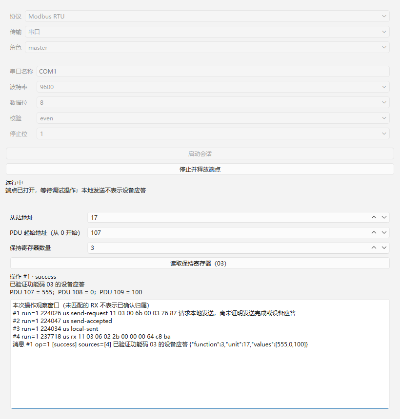
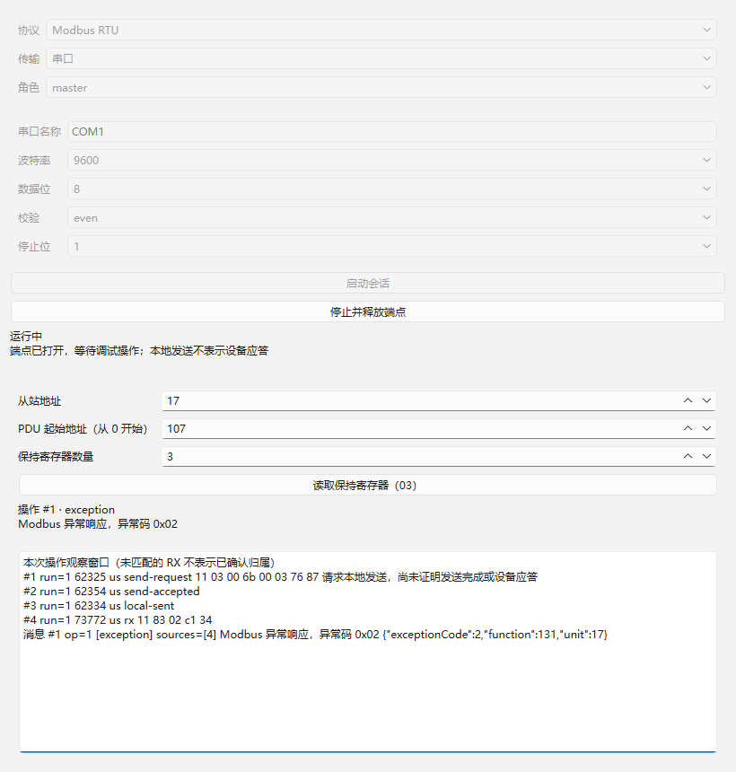
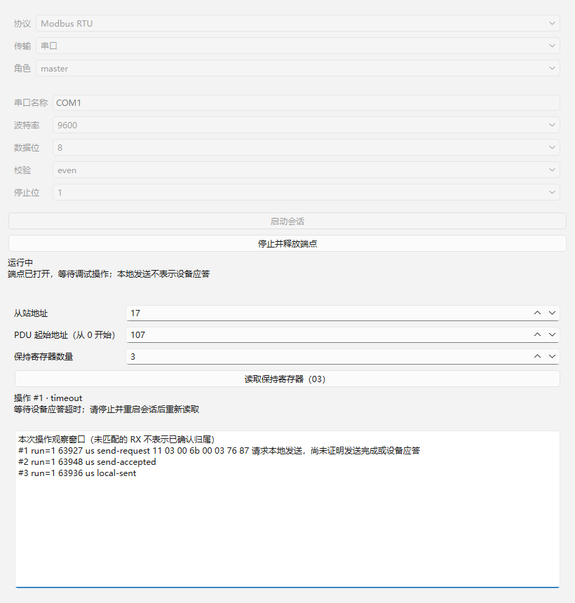

# 02：首次 RTU 保持寄存器读取验收

日期：2026-10-22（Asia/Shanghai）。前置基线：01 提交 `f5b962d8547083114b188114e91158af3b87b943`。范围仅 [02](../../issues/02-rtu-first-register-read.md)，读取 AGENTS、本地 issue/领域/标签约定、GLOSSARY、相关 ADR、正式规格、架构、接口契约、实施索引、既有工具链和 01 验收证据后实施。

## 实现路径与范围

落地最小读取前按一手资料完成 [Modbus 实现路径核验](../../modbus-implementation-path.md)。选择项目自有无 I/O 内核，复用统一通道与 QSerialPort；文档比较 Qt QModbus RTU 整栈和 libmodbus，列出主从及八功能码扩展依据与分发边界。未新增 Modbus 第三方库，也未宣称后续功能已实现。

当前只支持主站单次功能码 03，Unit ID 1..247，PDU 起址 0..65535、数量 1..125 且范围不越界。结果为原始 16 位值；正常应答、异常、发送失败、应答超时和取消分别表达。没有自动重试、轮询、写入、其他数据区、从站、工作区、导出或磁盘记录。

SDK 2 / 产品 0.2 显式升级接口 IID 和构建指纹，配套重新构建宿主、协议和传输 DLL。协议插件持有 RTU 行为及操作视图，宿主管理操作身份、通道、原始记录和生命周期，视图不直接访问端点。

## 执行环境与复现

复用 Windows 11 x64、Qt 6.12.0 LLVM-MinGW、Clang 22.1.7、C++17、CMake 3.30.5、Ninja 1.12.1 和既有 VS Code 环境。没有安装工具、切换编译器或改变全局 PATH。Qt 本身是 release 构建，产品与插件分别按 Debug/Release 配套编译。

```powershell
./scripts/verify.ps1
./scripts/run.ps1
```

验证脚本配置、构建并执行两个 CTest 入口，保存结果和实际测试窗口截图，自动生成产物/日志/截图 SHA-256；01 的既有证据没有被覆盖。命令退出码逐项检查，最终脚本退出 0。

| 检查 | Debug | Release |
| --- | --- | --- |
| 配置 | [成功](qt-llvm-debug/configure.log) | [成功](qt-llvm-release/configure.log) |
| 构建 | [成功](qt-llvm-debug/build.log) | [成功](qt-llvm-release/build.log) |
| CTest | [2/2 通过](qt-llvm-debug/ctest.log) | [2/2 通过](qt-llvm-release/ctest.log) |
| 01 生命周期回归 | [13 passed / 0 failed](qt-llvm-debug/test-results.txt) | [13 passed / 0 failed](qt-llvm-release/test-results.txt) |
| 02 读取检查 | [36 passed / 0 failed](qt-llvm-debug/read-results.txt) | [36 passed / 0 failed](qt-llvm-release/read-results.txt) |
| SHA-256 | [产物及证据](qt-llvm-debug/sha256.txt) | [产物及证据](qt-llvm-release/sha256.txt) |

每种配置共 49 项 Qt Test 通过、0 failed、0 skipped；包含两个套件各自的初始化/清理（4 项）及参数化数据行。实际行为检查行 45 项。可执行文件、DLL 和构建缓存留在忽略的 `build/<preset>`，提交源码、复现脚本及验收证据。可选 Vulkan headers 提示未阻止 Widgets 配置和构建。

## 验收映射

| 条件 | 会话公开入口测试与观察结果 |
| --- | --- |
| 请求与响应 | `readThroughSessionAndTraceSources`：观察请求 `01 03 00 00 00 02 C4 0B`；拆分响应 `01 03 04 00 0A 00 14 DA 3E` 返回 10、20；消息关联两条真实来源 ID |
| 规范示例与地址 | `specificationVectorAndZeroBasedAddress`：按应用协议 §6.3 的 006B / 0003 示例，Unit 17 请求 `11 03 00 6B 00 03 76 87`，响应返回 PDU 107..109 的 555、0、100，没有使用 40001 偏移 |
| 参数校验 | `invalidRequests` 8 个数据行拒绝广播、非法 Unit、负地址、零数量、数量 126、范围越界、非整数及缺失参数；没有发送数据 |
| 原始错误保留 | `responseErrors` 7 个数据行覆盖 CRC 错误、错误 Unit/功能码/字节计数、截断、噪声和没有可信边界的连续拼接；都不能变成成功，原始数据保留，最终超时且不重试 |
| 异常 | `exceptionIsNotTimeout`：CRC 有效的 `01 83 02 C0 F1` 显示异常码 02，关联该操作，不冒充正常值或超时 |
| 提交/本地/设备分离 | 接纳后为 submitted；本地完成后为 sent，仍未完成操作；只有验证响应后为 success。`localSendCannotConfirmDevice` 同时验证本地回调晚于 RX 时不会提前成功，重复最终结果被忽略 |
| RTU 时序 | `silenceBoundaries` 覆盖 9600/19200 的字符时间以及 38400/115200 的固定等待；`interCharacterGapAndRecovery` 用可信静默元数据验证 >t1.5 丢弃、等于 t1.5 可继续、t3.5 后判帧及恢复 |
| 主机分块延迟 | `delayedHostChunksDoNotImplyWireSilence`：无可信线路时间的 4+5 字节响应，主机交付相隔 5 ms，仍能保守组装成功，不把分块延迟宣称为帧内违规 |
| 噪声与有界等待 | `idleNoiseDoesNotStrandQueuedRead`：提交前单字节残留不会卡住读取，也不伪造操作归属；持续噪声下等待空闲有期限，超时确认没有发送 |
| 超时与失败 | `localCompletionDeadlineUsesObservationTime` 区分迟到发送完成及及时观测但排队延迟；`sendRejectedAndLocalSendTimeout` 验证拒绝和未收到本地完成；失败/停止/旧事件由 `sendFailureCancellationAndOldEvents` 覆盖 |
| 有界记录 | `boundedRawCacheAndOversizedFrame` 注入 300 个块，缓存保持 256 条，过期计数可见，来源查询明确为空，超长帧不变成成功 |
| 产品计时路径 | `qtTimerDrivesProtocolWithoutManualPoll` 通过生产 QElapsedTimer/Qt 定时器与可控端点完成读取，不调用手动 poll |
| 界面流程 | `widgetReadFlow` 三行点击原生 Widgets 的启动/读取按钮，检查 success / exception / timeout、PDU 数值及收发明细，生成对应截图 |

测试控制入口为 DebugSession 的 start/stop/submit/poll 及公开查询；未断言私有容器或辅助函数顺序。通道替身仅替换 I/O，继续使用真实 Modbus DLL 和宿主记录/会话逻辑，不注册测试协议。规范 PDU 示例、固定 RTU 字节向量与实际端点证据分开描述。

## 原始记录与时间边界

接收经统一宿主入口先写入原始缓存、获得 ID，再交给协议；解析失败和未知数据仍保留。记录最多 256 条，每条 4096 字节；消息最多 256 条，操作最多 128 项，观察引用最多 512 项。记录 ID 跨启停不复用，过期来源查询返回空值，界面列出缺失来源；超过引用上限的数量单独提示。操作观察窗口中的 RX 不代表经过协议确认的响应归属，匹配成功/异常后消息才引用操作 ID。

实际 QSerialPort 只报告字节块，不提供逐字节线路间隙。ReceiveChunk.idleBeforeUs 仅用于确知的线路静默；实际串口路径留空，测试传输显式注入可信值。无可信时间时，不完整响应不因主机块间延迟直接被截断；内核保守组装候选完整帧后等待主机观测静默再校验，或到应答期限保留错误原因。空闲/待发送时的无归属残留可在观测静默后清理，不强加给新的操作。

默认应答超时 1000 ms，公开配置允许 1..60000 ms 的整数。等待空闲期限为 max(配置超时, 1000 ms)，本地发送期限为配置超时；本地完成必须按其观测时刻校验原期限，并由观测时刻开始应答期限。期限内最后一块已经到达时，可再等一个 t3.5 判定帧边界；迟到响应不作为成功。已发送但未确认后，要求停止重启，避免在同次运行内把迟到响应强关联新操作。

## 界面证据

以下全部是实际原生 Qt 测试窗口、可控传输响应，不是硬件互通证据。Release 同名截图也已保存。







01 的真实串口打开错误、可控运行和停止截图作为回归也保存在本目录。截图经目视检查，中文、PDU 地址和值、状态、收发字节及来源信息可读。

## 审查与修复

使用 `code-review` 技能，固定基线为 01 的 f5b962d，两名子代理独立执行 Standards / Spec 审查；实现尚未提交时查看相对基线的工作树差异及新增文件，修复后再次复核。

| 轴 | 初审与后续发现 | 修复及最终结果 |
| --- | --- | --- |
| Standards | 0 项 | 增量符合项目约定、协议视图及统一通道边界；最终复核 0 项剩余问题 |
| Spec | 初审 P1 主机块时间误判为线路静默；P2 迟到发送完成延长期限；修复复核另发现 P2 短噪声可能使等待挂起 | 区分可信间隙与块观测；保存发送完成观测时间并校验原期限；空闲残留清理与有界等待；分别补回归，最终 0 项剩余问题 |

一次新增噪声回归曾因断言错误失败：它把提交前噪声期望为本次操作的消息。修正为全局消息中可查、该操作消息中无虚假归属后，完整 Debug/Release 重新通过。上表和日志记录的是最终结果。代码/文档提交前执行差异空白检查，直接捕获的 `*.log` 保留工具原始行尾空格，不纳入该检查。

## 未覆盖条件

- 本机仍枚举到 1 个串口；未打开现有设备、未连接独立 Modbus 对端。实际 serial DLL/QSerialPort 仅验证 COM9999 打开失败及再次启动，此项没有真实硬件收发、成功打开、线路 CRC/静默时间或独立对端互通结论。
- Windows/USB 接收聚合可隐藏物理字节间隙；无逐字节时间戳时不能保证检测块内 t1.5，主机定时也不证明物理微秒精度。模拟规则与正常本地计时入口通过，不代替 13 的硬件时序和负载验收。
- QSerialPort 部分写入代码已实现，实际驱动的部分写入、拥塞、物理断线和硬件方向控制尚未验证；当前软件替身验证了端点接纳、完成、拒绝、失败及超时的公开行为。
- RTU 无事务编号，跨人工重启后的同地址/长度迟到物理响应仍无法仅靠本项 SDK 证明新旧；操作人员应确认线路安静和设备状态。本项不增加自动重连或重发。
- 仅提供本次操作的有界记录/消息关联；完整跨操作筛选、导出、磁盘、容量配置及过载压测留在 11/12/13。自有内核不附带额外 Modbus 库许可证，Qt 及项目本身的发布许可事项沿路径核验说明，最终交付由 19 验证。
- 既有未跟踪规格、ADR 和其他任务文件保持原状；只提交 02 实现及直接对应的任务/索引/路径核验/证据。提交身份沿用 01 的命令级 `Codex <codex@local.invalid>`，不改全局身份或信任配置。
