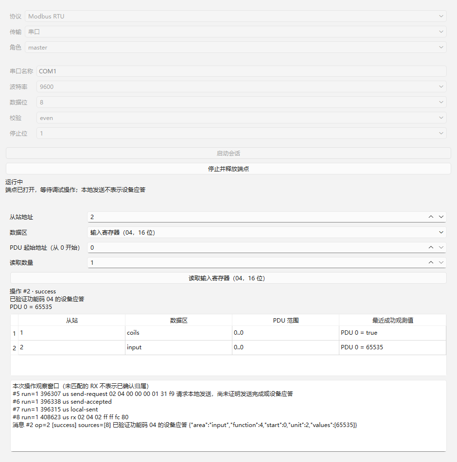

# 03：四类 Modbus 数据区读取验收

日期：2026-10-22（Asia/Shanghai）。范围仅 [03](../../issues/03-modbus-four-area-read.md)。实施 worktree 为 `rtu-master`，分支 `codex/rtu-master`，共享文档基线 `fb14cb8`、实施前基线 `abb5169`。已读取 AGENTS、领域/issue 约定、GLOSSARY、ADR 0001–0009、正式规格、架构、接口契约、实施索引与工具链说明；01/02 沿用已有提交与证据。

## 实现与公开接口

Modbus 插件新增 `read-coils`（01）、`read-discrete`（02）、`read-input`（04），保留 `read-holding`（03）。参数统一 `unit/start/count`，Unit 1..247；PDU 起址 0..65535，位区数量 1..2000、寄存器区 1..125，范围不能越界。成功结果为 `unit/area/function/start/values`，area 为 `coils/discrete/holding/input`；位值为 JSON bool，寄存器为 0..65535 整数。位响应低位在先，最后字节未使用高位必须为 0。

协议视图提供四区下拉与读取按钮，按从站与数据区保留最近成功值，列明 PDU 范围；失败显示当前操作状态，不用失败数据覆盖成功历史。寄存器和协议语义继续留在插件，宿主与 SDK 未增加 Modbus 分支。沿用单在途、RTU CRC/时序、统一记录入口与现有失败恢复规则，没有实现后续轮询、写入或自动重试。

## 环境与复现

Windows x64；Qt 6.12.0 LLVM-MinGW、Clang 22.1.7、C++17、CMake 3.30.5、Ninja 1.12.1，宿主与插件分别配套 Debug/Release。无工具安装或全局 PATH 修改。可选 Vulkan headers 缺失提示未阻止 Widgets 构建。

```powershell
./scripts/verify.ps1 -EvidenceId 03
```

脚本增加 `-EvidenceId` 参数（默认保持 02），证据写入指定项，复制全部 `*-results.txt` 并为所有 `*tests.exe` 和产品/DLL/证据生成 SHA-256，未覆盖 01/02。

| 配置 | 构建与 CTest | Qt Test |
| --- | --- | --- |
| Debug | [配置](qt-llvm-debug/configure.log)、[构建](qt-llvm-debug/build.log)、[2/2 通过](qt-llvm-debug/ctest.log) | [生命周期 13](qt-llvm-debug/test-results.txt) + [读取 43](qt-llvm-debug/read-results.txt)，0 failed / 0 skipped |
| Release | [配置](qt-llvm-release/configure.log)、[构建](qt-llvm-release/build.log)、[2/2 通过](qt-llvm-release/ctest.log) | [生命周期 13](qt-llvm-release/test-results.txt) + [读取 43](qt-llvm-release/read-results.txt)，0 failed / 0 skipped |

每配置 56 项包括两个套件各自初始化/清理 4 项，实际行为检查行 52 项。产物与日志/截图哈希见 [Debug](qt-llvm-debug/sha256.txt)、[Release](qt-llvm-release/sha256.txt)。构建产物保持忽略。

## 验收映射

| 条件 | 公开会话入口与观察证据 |
| --- | --- |
| 四区、布尔/16 位、PDU 从 0 开始 | `fourAreaSpecificationVectors` 四行：01 的 PDU19/37位、02 的 PDU196/22位、03 的 PDU107/3寄存器、04 的 PDU8/1寄存器。01/02/04 PDU 采用 Modbus Application Protocol V1.1b3 §6.1/6.2/6.4 固定示例，03 保留 §6.3 示例；请求与响应为预先固定 RTU 字节向量，不通过产品编码器生成预期。返回值与 LSB 顺序逐项检查 |
| 边界与异常 | `fourAreaBoundsAndExceptions` 遍历四区：最大数量加一、越界范围、分数地址和零数量均 invalid 且无发送；65535 单项可接受；各区异常码 02 为 exception 且没有 values；2000 位读取请求固定向量通过 |
| 错报文不冒充观测 | `wrongAreaResponseCannotBecomeObservation`：01 等待中收到 CRC 正确的 02，相同地址/长度仍 unmatched；CRC 正确但高位填充非零的 01 为 invalid，保留消息和原因；之后正确 01 才成功。既有 `responseErrors` 保留 CRC、错误 Unit/功能码/长度、截断及噪声回归 |
| 跨块与回溯 | 四个规范向量均拆成两块，通过 DebugSession start/submit/operation/messages/trace 入口确认两来源引用及正确结果；既有生命周期、时间和缓存回归全部通过 |
| 界面与按设备保留 | `widgetFourAreaObservations` 实际启动窗口、选择 01 读取 Unit1=true，再选择 04 读取 Unit2=65535，检查两行成功历史和两种数量上限，生成截图；既有 success/exception/timeout Widgets 三行继续通过 |

规范 PDU 来源为已在 [实现路径核验](../../modbus-implementation-path.md) 引用的 Modbus 官方应用协议；固定 CRC 由独立工具事先计算。测试只替换传输和时间，使用实际 DLL、公开会话和 Widgets，不将测试端点注册成产品支持组合。

## 界面证据

以下为原生 Windows Qt 测试窗口，使用可控传输；Release 同名截图也已保存。目视检查中文可读、Unit1 线圈历史与 Unit2 输入寄存器分列、布尔值和 65535 显示正确。



## 审查与限制

实施者按验收清单自审：参数边界、四种功能码匹配、LSB 位解码、长度/CRC、异常和历史标识均已检查；集成审阅建议补充末字节高位填充校验，已修复并补充 CRC 有效的错误向量。最终修改后 Debug/Release 全量重新通过；独立整体审查由集成分支统一执行并记录。代码/文档差异空白检查排除工具原始 `*.log`。

真实串口成功收发、独立硬件对端、USB 聚合、物理 RTU 静默与驱动断线时序未验证；仍沿用 02 对可信间隙与主机分块时间的区分。现有真实 serial DLL 的不存在端口失败路径通过，模拟成功不构成硬件互通证据，硬件条件留给 13。
