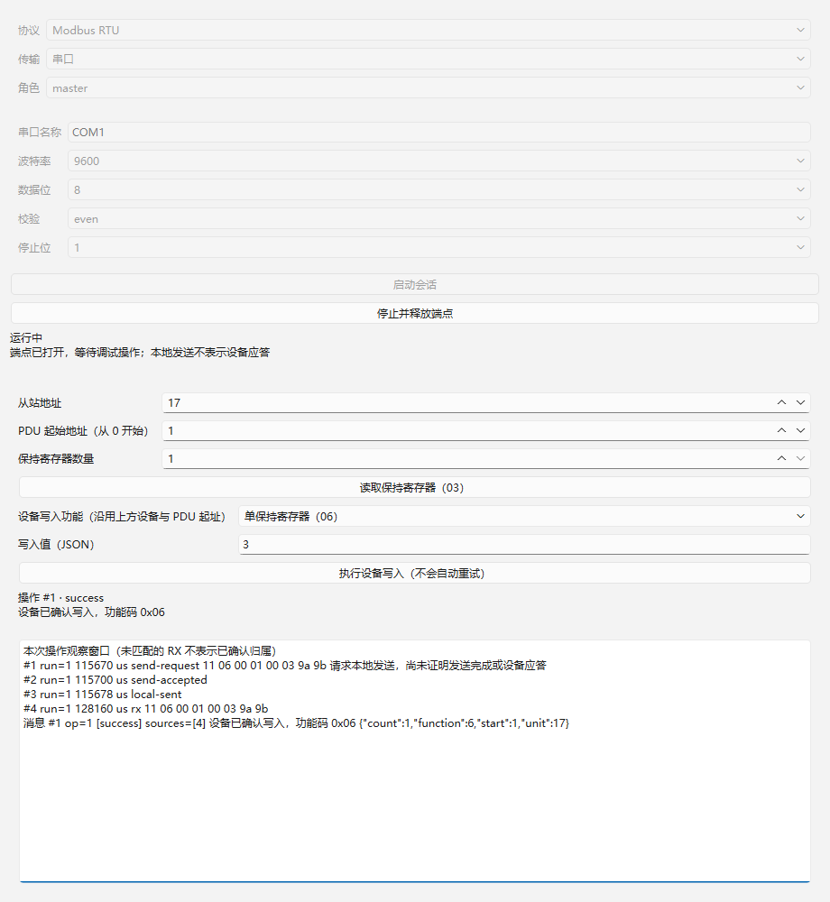
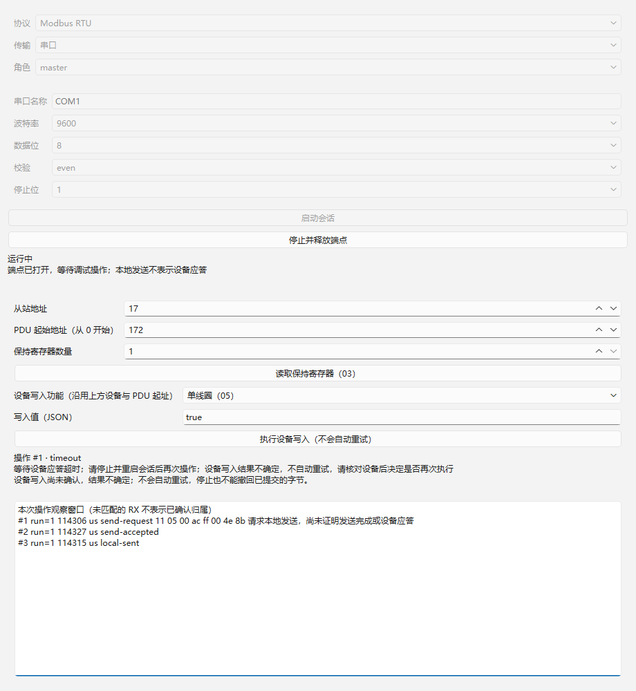
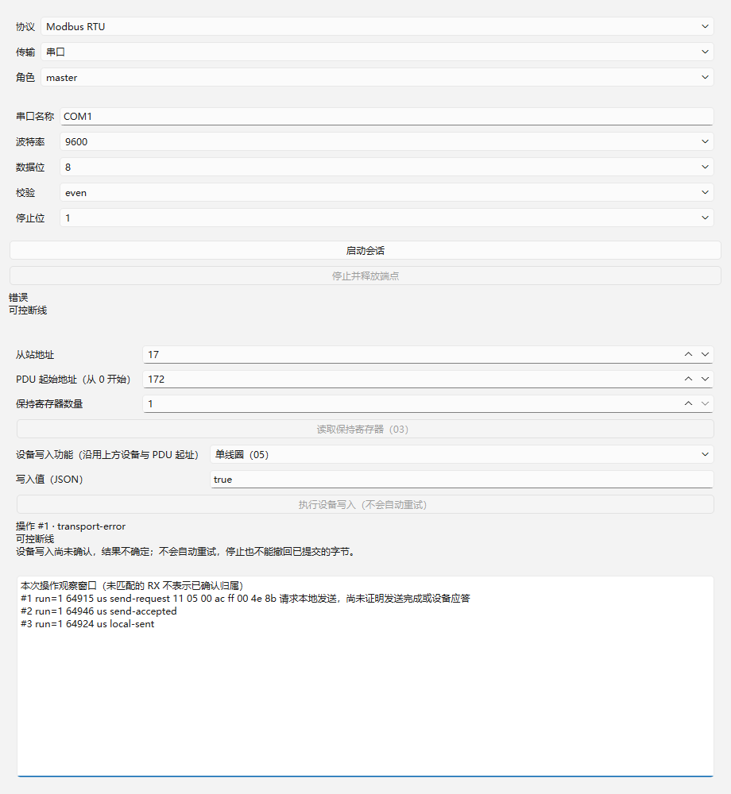

# 04：显式设备写入验收证据

日期：2026-10-22。实施分支 `codex/rtu-slave`，独立 worktree `.worktrees/rtu-slave`，共享基线 `abb5169`；前置 01/02 代码提交分别为 `f5b962d` / `1fc90db`，已读取对应验收记录，未重复实施。按 AGENTS、领域/issue 约定、正式规格、实施索引、架构、接口契约及工具链说明完成本项。

## 实现与公开操作

Modbus 插件沿用统一通道发送，不增加主体协议分支或 SDK 接口。新增 `write_pdu.h/cpp` 无 I/O 模块负责参数验证、PDU 编码与预期回显，可供后续从站复用。

| action | 参数 | 确认要求 |
| --- | --- | --- |
| `write-single-coil` | `unit`、`start`、布尔 `value` | 05 完整回显起址及 FF00/0000 |
| `write-single-register` | `unit`、`start`、整数 `value` 0..65535 | 06 完整回显起址及值 |
| `write-multiple-coils` | `unit`、`start`、布尔数组 `values`，1..1968 | 0F 完整回显起址及数量 |
| `write-multiple-registers` | `unit`、`start`、整数数组 `values`，1..123 | 10 完整回显起址及数量 |

Unit 为 1..247，起址为从 0 开始的 PDU 地址，范围不得超过 65535；本项需要设备应答，拒绝广播。线圈按低位优先装入字节，尾部未用位为零；寄存器按高字节先发送。非法类型、分数、空数组及越界在发送前明确拒绝。界面保留读取，增加写入功能选择、JSON 值输入及独立设备写入按钮；不会把文件保存当作设备写入。

状态依次为 queued / submitted / sent，设备确认后 success，合法异常为 exception；不以本地发送完成冒充设备确认。写入未确认后本地超时/失败产生 uncertain 提示，断线与停止经宿主终结后仍保留 sendAccepted 等事实，插件视图显示结果不确定。不会自动重试或在重启后补发。超时后为避免迟到 RTU 回显误关联，沿用停止/重新启动后由操作人员再次执行的规则；新提交生成新 ID。

## 环境与执行

复用 Windows x64、Qt 6.12.0 LLVM-MinGW、Clang 22.1.7、C++17、CMake 3.30.5、Ninja 1.12.1。没有安装新工具、改变全局 PATH 或切换架构。Qt 自身为 release 构建，产品与插件分别配套 Debug / Release。专用脚本避免覆盖 01/02 证据：

```powershell
./scripts/verify-04.ps1
```

| 检查 | Debug | Release |
| --- | --- | --- |
| 配置/构建 | [成功](qt-llvm-debug/build.log) | [成功](qt-llvm-release/build.log) |
| CTest | [3/3](qt-llvm-debug/ctest.log) | [3/3](qt-llvm-release/ctest.log) |
| 生命周期 | [13 passed](qt-llvm-debug/test-results.txt) | [13 passed](qt-llvm-release/test-results.txt) |
| 读取回归 | [36 passed](qt-llvm-debug/read-results.txt) | [36 passed](qt-llvm-release/read-results.txt) |
| 写入 | [36 passed](qt-llvm-debug/write-results.txt) | [36 passed](qt-llvm-release/write-results.txt) |
| SHA-256 | [清单](qt-llvm-debug/sha256.txt) | [清单](qt-llvm-release/sha256.txt) |

每配置共 85 项 Qt Test 检查，含三个套件各自初始化与清理 6 项，实际行为行 79 项；0 failed、0 skipped。可执行文件/DLL 与构建缓存由 build 忽略规则排除，保留源码、测试日志、截图及哈希。可选 Vulkan headers 缺失提示未影响本次 Widgets 构建。

## 验收映射与向量

依据 [Modbus 应用协议 V1.1b3](https://www.modbus.org/file/secure/modbusprotocolspecification.pdf) §6.5、6.6、6.11、6.12 的 PDU 示例与约束，固定 RTU 向量验证编码；CRC 字节独立预计算，测试不调用产品编码器生成期望值。

| 测试 | 外部行为 |
| --- | --- |
| normativeVectors，8 行 | 05：`110500acff004e8b`；06：`1106000100039a9b`；0F：`110f0013000a02cd01bf0b`；10：`11100001000204000a0102c6f0`，各自验证正常/异常响应、拆成两块的来源关联；超时推进后无重发 |
| invalidParameters，11 行 | 广播、非法 Unit/起址/值、分数、非布尔线圈、空数组、尾址越界、124 寄存器、1969 线圈、混合类型均无发送 |
| timeoutAndManualRepeat | 超时明确不确定，一千万微秒推进无重试；停止/重启无补发，人工重新提交得到新 ID，成功且来源记录与先前操作区分 |
| failuresNeverRetry，5 行 | 通道拒绝、本地失败、本地发送超时、events.failed 断线、stop 均结束且不重试；拒绝 sendAccepted=false，其余为 true |
| invalidEchoNeverConfirms | CRC 有效的错误功能码/值/起址、损坏 CRC 均不能确认当前写入，原始记录可查，最终超时 |
| widgetWrite，8 行 | 点击四个功能入口成功；异常、超时、断线、停止均显示相应状态；后三者显示不确定；所有行只发送一次 |

主测试入口为 DebugSession.start/submit/stop/poll/operation/messages/traces；仅底层 EndpointFactory 与时钟可控。没有将测试 Adapter 加入支持组合。保留真实插件及宿主通道与记录协作。

## 原生界面证据

截图由实际 Windows Qt 测试窗口 grab 生成，可控传输，不代表真实硬件。已目视检查中文与不确定提示可读。







Release 保存同名截图；四种写入与异常/停止亦有截图。

## 审查及边界

实施者按本项清单检查统一通道、四功能码语义、状态分离、无自动重试及界面入口；补充同功能回显值/起址不符和宿主断线/停止回归，最终测试通过。整体 Standards / Spec 独立审查由集成分支统一执行并追加结果。

未连接实际设备，未验证独立硬件对端、串口方向控制/回显、物理断线及 Windows 微秒时序。保留 02 的可信线路间隙与主机观测分离，不把可控传输测试当作 13 验收。RTU 无事务编号，跨人工重启相同回显仍须操作者确认设备及链路状态。本项没有轮询、自动读取重试、从站、工作区或磁盘记录。
