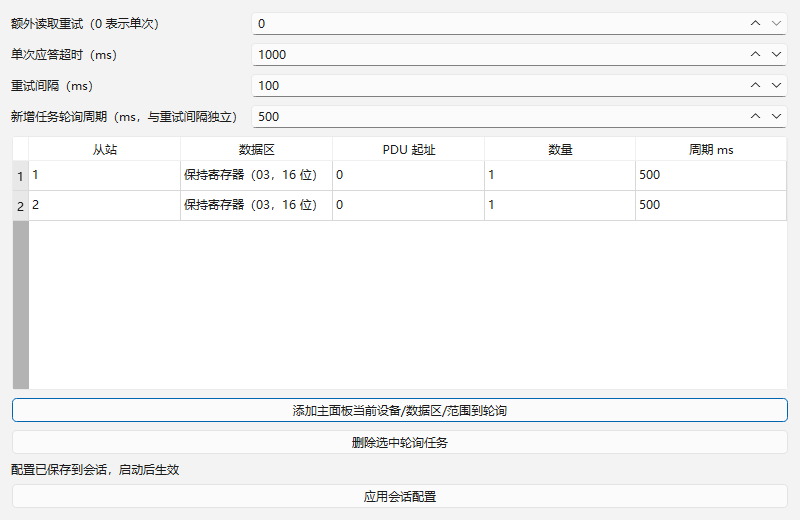
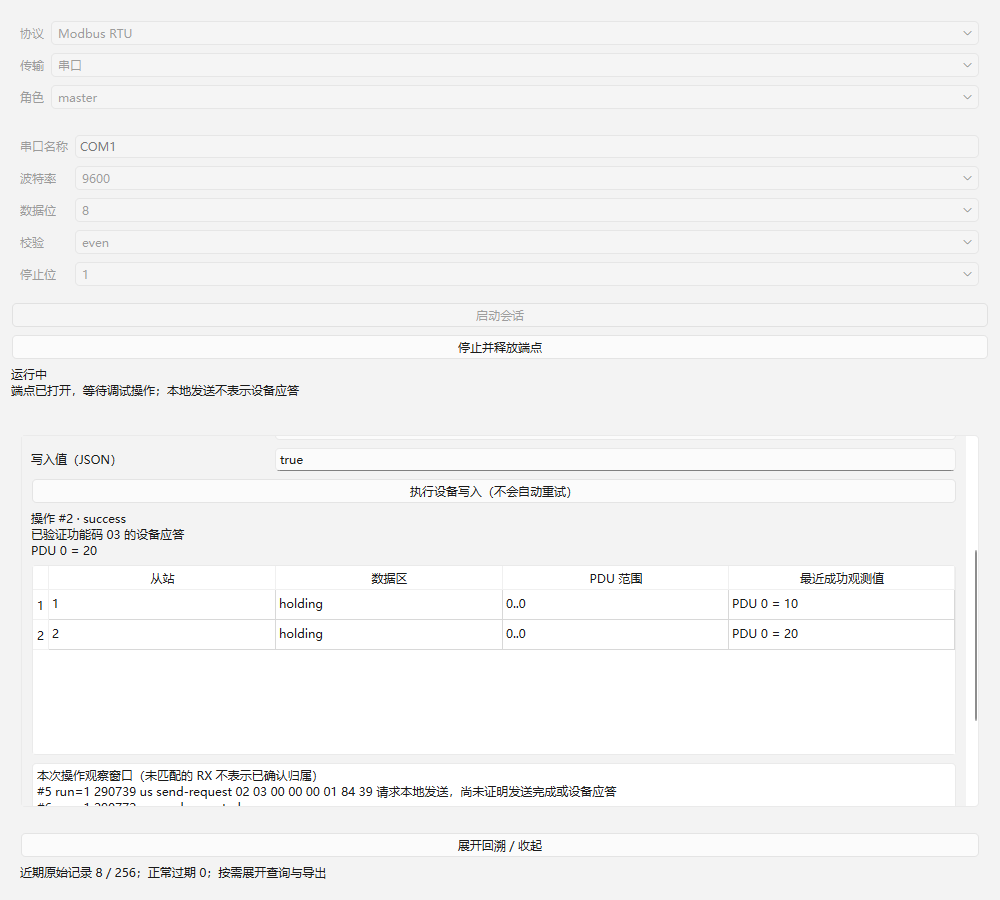

# 05：多设备轮询与会话级读取重试验收

日期：2026-10-22（Asia/Shanghai）。范围：[当前05](../../issues/05-rtu-polling-read-retries.md)。独立 worktree `rtu-master`、分支 `codex/rtu-master`；先合入集成 `7d324f4`（03/04），再合入 `d43cabb`（11及其索引记录），基于既有 Qt/LLVM-MinGW、01/02和已确认架构实施。已读取 AGENTS、领域与issue约定、正式规格、架构、接口契约、当前索引和工具链说明。

## 交付与边界

- 一个RTU主站串行调度所有手动操作与轮询，最多64项等待操作、64项轮询配置，只有1项在途。手动排队优先于新轮询，到期轮询轮转；任务周期从该任务上次结束计时，独立于重试间隔。停止取消当前和排队操作，不继续定时发送。
- 会话默认 `extraReadRetries=2`、`responseTimeoutMs=1000`、`retryIntervalMs=100`，分别限制0..10、1..60000ms、0..60000ms；0次额外重试只发送一次。`polls`每项包含 `unit/action/start/count/intervalMs`，周期10..3600000ms，action只能四区读取。配置校验原子化，错误不替换旧配置。
- 界面使用独立配置对话框，添加主面板当前设备/区/范围、删除任务、调整重试和周期并应用。停止状态保存启动配置；运行中需等待当前和排队操作结束再应用。插件主体区域可滚动，停止按钮仍在通用宿主顶部。
- 仅“等待有效读取应答超时”进入自动重试。CRC/长度错误先记录，至期限仍无有效响应才按超时处理。协议异常、发送拒绝、本地失败和本地完成超时不自动重试。设备写入始终不自动重试、不能加入轮询。
- SDK4增加 `ProtocolServices.submit/publishConfiguration`、`SessionAccess.config/configure`。轮询仍由宿主分配逻辑操作ID，运行时配置由协议发布原始JSON供保存；宿主不添加Modbus字段分支。`retry-wait`为未完成状态。SDK/IID/构建指纹同步升级，宿主、协议、传输与测试插件配套重编译。
- 每次传输send的ID为不透明发送令牌：首次保持逻辑ID以兼容既有端点，后续尝试使用独立令牌；宿主仅接纳当前令牌最终结果，旧尝试回调记录为stale。每次发送metadata保留 `attempt/sendId`；逻辑ID贯穿多次尝试及其原始记录，不能将本地发送完成当作设备确认。

## 迟到响应与来源不确定

RTU没有事务号。同一逻辑读取的重试后响应可完成该逻辑读取，但消息标记 `attempt=0` 和 `possibleAttempts`，操作结果包含 `attemptAttributionUncertain=true`；不能声称它属于最后一次尝试。间隔/隔离期间到达的有效流量标记late、operationId为0，经原始观察窗口可查。

读取尝试耗尽后，隔离“当前应答超时+重试间隔”后继续等待t3.5空闲；连续噪声的待发送/重试等待也有期限。某设备不会令整个轮询永久悬挂。有限隔离不能证明任意迟到已消失：同设备/功能/数量的后续候选响应标记 `freshnessUncertain=true`，消息operationId保持0，通过观察来源可查；详情明确“不能证明新采样”，候选值不写入最近成功观测表。最多保留64个超时响应形状，超过后保守标记本运行全部读取来源不确定，不能因淘汰形状而伪装恢复确定。停止重新启动才清除这些运行状态。

发送失败不重试；未确认设备写入继续要求操作人员核对设备并自行决定。自动重连/运行恢复属于09，本项没有越界实现。停止与重新启动的旧运行回调继续由既有代次机制隔离。

## 环境与复现

Windows x64；Qt6.12.0 LLVM-MinGW、Clang22.1.7、C++17、CMake3.30.5、Ninja1.12.1。未安装依赖或修改全局PATH；Qt自身为release，产品及插件按相应Debug/Release配套。可选Vulkan headers缺失不阻止Widgets构建。

```powershell
./scripts/verify.ps1 -EvidenceId 05
```

| 配置 | 配置/构建/CTest | Qt Test结果 |
| --- | --- | --- |
| Debug | [配置](qt-llvm-debug/configure.log)、[构建](qt-llvm-debug/build.log)、[5/5通过](qt-llvm-debug/ctest.log) | [生命周期13](qt-llvm-debug/test-results.txt)、[读取43](qt-llvm-debug/read-results.txt)、[写入36](qt-llvm-debug/write-results.txt)、[回溯10](qt-llvm-debug/trace-results.txt)、[轮询15](qt-llvm-debug/poll-results.txt) |
| Release | [配置](qt-llvm-release/configure.log)、[构建](qt-llvm-release/build.log)、[5/5通过](qt-llvm-release/ctest.log) | [生命周期13](qt-llvm-release/test-results.txt)、[读取43](qt-llvm-release/read-results.txt)、[写入36](qt-llvm-release/write-results.txt)、[回溯10](qt-llvm-release/trace-results.txt)、[轮询15](qt-llvm-release/poll-results.txt) |

每配置117 passed、0 failed、0 skipped，含5套件初始化/清理10项，实际行为检查行107项。产物、日志、结果与截图SHA-256见 [Debug](qt-llvm-debug/sha256.txt)、[Release](qt-llvm-release/sha256.txt)。构建产物保持忽略，01/02/03/04/11原证据没有覆盖。

## 公开入口验收映射

| 验收点 | 测试与外部观察 |
| --- | --- |
| 默认重试/独立间隔 | `defaultTwoRetriesAndIndependentGap`：首次+2次额外，共3次发送；单次1000ms，间隔100ms前不发送；操作保持未完成直到耗尽；3条send-request和3条attempt-timeout可查；前尝试本地回调不能完成新尝试 |
| 0次与异常 | `zeroRetriesAndExceptions`：显式0只发送一次；隔离结束后的异常02不重试；`writeCannotEnterRetryOrPollPath`：即使读取重试设10，写入超时也只有一次且结果不确定；写动作作为轮询配置被拒绝 |
| 迟到与归属 | `lateGapAndAmbiguousRetryResponse`：间隔内响应late/op0，重试响应的attempt为0、possibleAttempts=[1,2]；`previousLogicalTimeoutHasUncertainFreshness`：前逻辑读取超时后的同形候选标记freshnessUncertain、消息op0；其他设备正常值不污染 |
| 保守有界历史 | `manyTimeoutShapesStayConservativelyUncertain`：65个不同数量读取耗尽后，不因超出形状容量而伪装来源确定；另一设备候选仍保守标记 |
| 手动与轮询统一总线 | `manualAndPollingShareOneBus`：设备1轮询在途时手动设备3只排队，收到1应答后才发3，再发2；结果按设备隔离，独立50/100ms周期驱动再次轮询；停止后无后续发送 |
| 故障设备与队列 | `exhaustedDeviceDoesNotStrandOtherPolls`：设备1耗尽并有界隔离后设备2继续成功；`boundedQueueAndStop`：当前+64排队，下一项明确invalid，停止全部cancelled，无发送 |
| 配置/错误 | `invalidSettingsDoNotOpenTransport`：负值、分数、错误JSON类型、非法设备/周期拒绝启动；`runtimeSettingsPersistAndTransportFailureDoesNotRetry`：运行时配置写回SessionConfig，非法修改保留旧配置，本地失败不重试；`crcFailureRetriesOnlyAfterDeadline`：CRC失败保留，未到期不提前重发 |
| 界面流程 | `widgetConfiguresTwoDevicesAndObserves`：真实Widgets读取默认参数、设0次和500ms周期、添加Unit1/2并应用，启动后两行独立值10/20，停止后至少600ms无发送，生成配置/观测截图 |
| 已有回归 | 01/03/04/11套件保留；02单次超时/错误向量明确设置0额外重试，忙时行为更新为统一排队。旧Widgets超时曾因仍用新默认2而违反旧“只1次发送”断言，修正为显式0后全套重跑通过 |

测试经DebugSession公开启停、submit、operation、messages、traces以及config入口，底层只替换传输与时间，使用实际DLL。不检查私有队列和容器调用顺序。

## 界面证据

原生Windows Qt测试窗口，使用可控传输，非硬件连接证据。Release保存同名截图。目视检查配置默认与独立周期可读，运行观测按Unit隔离，滚动视图能访问常用操作与观测，停止按钮保持可达。





## 审查与未覆盖条件

实施者按05验收清单自审。集成审阅建议的有界超时形状、不能丢弃taint后伪恢复、不可信任手工_pollIndex和可达界面均已落实；轮询映射由实际宿主操作ID维护，手工参数不能冒充内部轮询。所有最终代码变更后Debug/Release重跑通过。整体Standards/Spec独立审查由集成分支统一执行。

实际独立Modbus对端、成功物理串口收发、USB聚合及驱动/线路时序未验证。Windows计时不证明物理微秒精度；RTU任意迟到的不可辨识风险通过公开不确定标识表达，硬件支持范围与负载由13确认。当前模拟与软件计时结果不替代13，不启动14–19。
