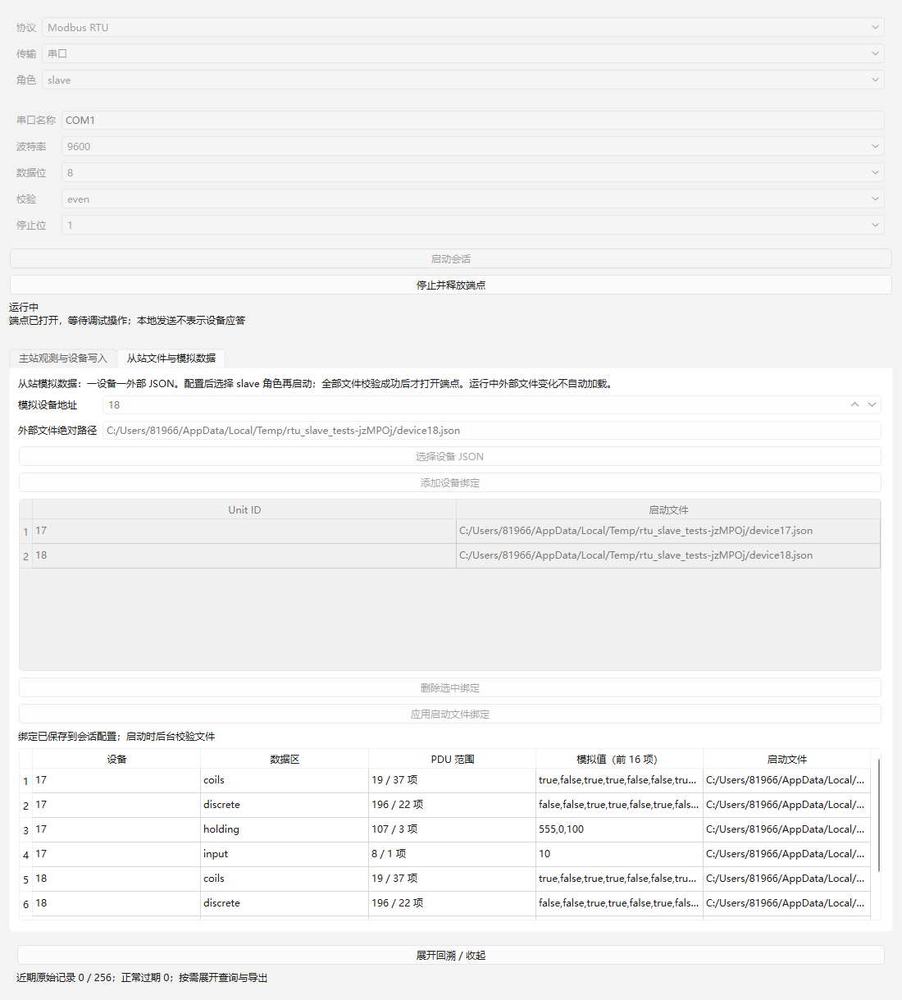
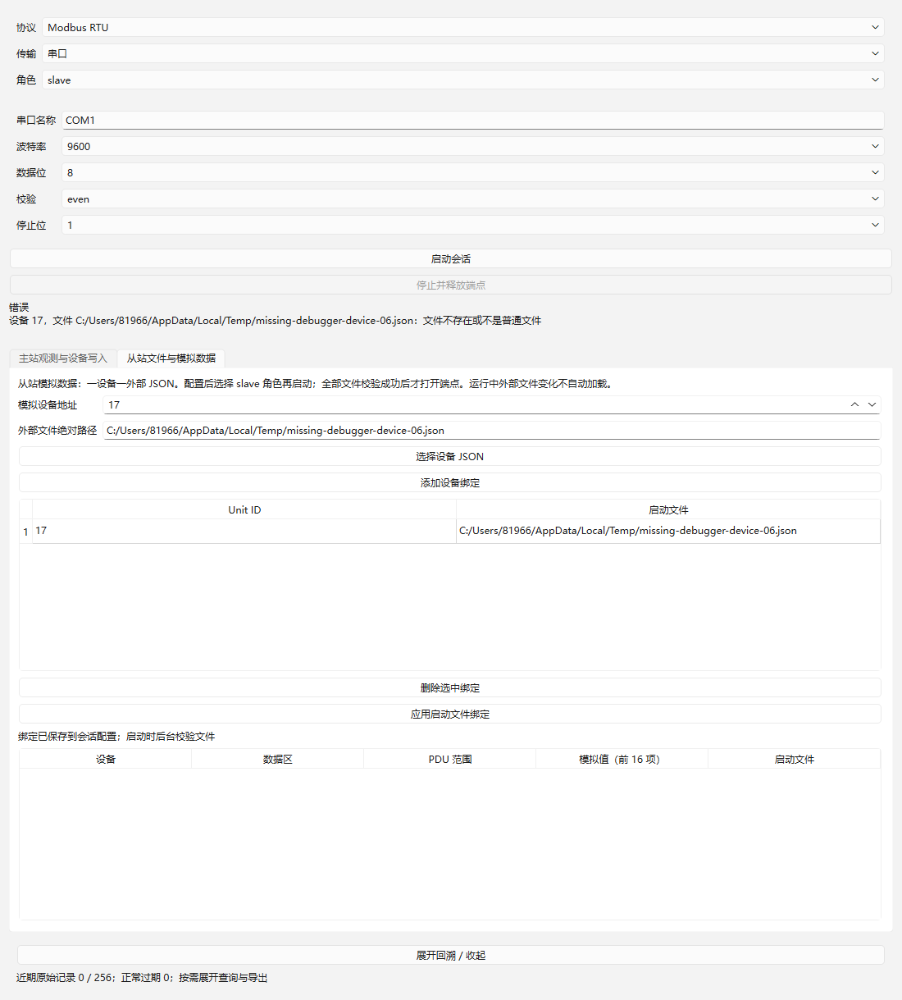

# 06：多设备从站 JSON 读取验收

日期：2026-10-22。独立 worktree `.worktrees/rtu-slave` / 分支 `codex/rtu-slave`；以前置 03/04 集成 `7d324f4` 开始，合入 11 基线 `dc07c77`，保留 01/02 已验收实现。按 AGENTS、本地 issue/领域约定、GLOSSARY/ADR、正式规格、实施索引、架构、接口契约及工具链说明实施本项，未启动 07/08 或硬件验收。

## 可交付流程

工作台支持 `slave` 角色，协议插件增加“从站文件与模拟数据”页。逐个选择 JSON、添加 Unit/路径绑定并应用后启动；后台读取并校验全部文件，全部成功才申请并打开端点。错误明确列出 Unit、路径和原因，不以零值或快照兜底。运行中显示各设备独立四区的范围、值和文件，主站观测值留在独立页与独立模型。

文件规则与示例见 [格式 v1](../../slave-data-format.md)。公开配置为 `protocol.devices=[{unit,path}]`，启动路径为绝对路径。四区必需，按 start/values 表达连续 PDU 范围；布尔区与 uint16 寄存器严格校验，未知字段原样保留。保护上限为 32 设备、4 MiB/文件、16 MiB/会话；后台准备全进程最多 4 个任务，包含取消后尚未完成的任务，不无限排队。

RtuSlave 处理 01/02/03/04 和异常响应；未知设备、广播读取、CRC/可信 t1.5 间隙错误不应答。运行中修改/删除外部文件不热加载；新一次启动重新校验。被动应答通过宿主统一分配发送 ID，经统一通道记录并保留请求来源字节区间；本地完成、拒绝、失败和 1 秒发送超时分别可见，无自动重发。

## 执行环境与复现

Windows x64、Qt 6.12.0 LLVM-MinGW、Clang 22.1.7、C++17、CMake 3.30.5、Ninja 1.12.1；没有安装新工具或修改全局 PATH。SDK 5 显式配套重编译宿主和插件，保留 11 的 SDK 3 字节区间/元数据扩展；05 的并行接口由集成时取并集，旧 DLL 不混装。

```powershell
./scripts/verify.ps1 -EvidenceId 06
```

| 检查 | Debug | Release |
| --- | --- | --- |
| 配置/构建 | [通过](qt-llvm-debug/build.log) | [通过](qt-llvm-release/build.log) |
| CTest | [5/5](qt-llvm-debug/ctest.log) | [5/5](qt-llvm-release/ctest.log) |
| 生命周期 | [13 passed](qt-llvm-debug/test-results.txt) | [13 passed](qt-llvm-release/test-results.txt) |
| 四区读取 | [43 passed](qt-llvm-debug/read-results.txt) | [43 passed](qt-llvm-release/read-results.txt) |
| 显式写入 | [36 passed](qt-llvm-debug/write-results.txt) | [36 passed](qt-llvm-release/write-results.txt) |
| 从站 JSON | [29 passed](qt-llvm-debug/slave-results.txt) | [29 passed](qt-llvm-release/slave-results.txt) |
| 查询导出 | [10 passed](qt-llvm-debug/trace-results.txt) | [10 passed](qt-llvm-release/trace-results.txt) |
| SHA-256 | [清单](qt-llvm-debug/sha256.txt) | [清单](qt-llvm-release/sha256.txt) |

每配置 131 项 Qt Test 检查（含五套件各自初始化/清理共 10 项，行为行 121），0 failed、0 skipped。构建产物留在忽略的 build 目录。既有 01/02/03/04/11 证据没有覆盖；本次全部日志与截图独立保存于 06。

## 验收映射

| 会话公开入口测试 | 外部可见结果 |
| --- | --- |
| fourAreaNormativeVectors，4 行 | 独立固定请求向量 01 `1101001300250e84`、02 `110200c40016baa9`、03 `1103006b00037687`、04 `110400080001b298` 得到对应规范响应；来源跨两块保留精确区间，主机分块交付相隔 5 ms 不误判截帧 |
| invalidStartup，15 行 | 缺文件、目录、无效 JSON、错误版本、缺数据区、位值/寄存器类型、分数、范围越界、重复 Unit/文件、相对路径、超大文件、Windows 独占锁导致不可读、空设备列表；全部无端点打开及发送 |
| errorsBroadcastAndIsolation | Unit 18 读得独立值 111，Unit 17 保持 555；非法地址/数量/功能返回 02/03/01；未知 Unit、广播读取与坏 CRC 无应答 |
| fileChangesOnlyOnRestart | 外部改值时原运行继续返回旧值；重启后返回 777；运行中删除仍能读取已加载数据，下一次启动拒绝且不开端点 |
| cancelledPreparationAndIndependentSession | 注入有界准备执行器延后完成，停止后重启再销毁；两份迟到准备均不开端点，另一主站会话继续运行 |
| preparationLimitAndCatalogLease | 4 份取消但未完成准备占用上限，第 5 份明确繁忙；删除会话/外部注册表引用后插件租约仍在，任务完成后释放，不产生迟到打开 |
| passiveSendFailureAndBoundedWait | 后端无 sent 产生 1 秒失败和可见来源，不自动重试；新请求、本地失败及拒绝均有明确消息 |
| trustedInterCharacterViolation | 可信 751 µs > t1.5 造成无应答，下一合法请求恢复 |
| widgetBindingsAndData / widgetMissingFileError | 原生 Widgets 添加两设备文件、选择 slave 启动、显示独立四区；缺文件显示设备/路径/原因，界面可用且未打开端点 |

向量依据 [Modbus 应用协议 V1.1b3](https://www.modbus.org/file/secure/modbusprotocolspecification.pdf) 的四区示例及异常规则，CRC 为固定预计算字节，测试不调用产品编码器生成期望值。主要入口为 DebugSession.start/stop/poll/snapshot/messages/traces，底层 EndpointFactory/时钟/准备执行器可控；真实 Modbus DLL、宿主和记录入口均保留。

## 原生界面

截图由 Windows Qt 测试窗口 grab 生成并目视检查，全部使用可控传输，不是硬件连接证据。数据表可滚动查看各设备四区，摘要显示前 16 项；路径与中文错误可读。





Release 保存同名截图。

## 生命周期与审查

通用 `ProtocolSession.prepareInBackground` 默认 false，保留主站参数错误同步 start(false) 契约；从站声明后台准备。宿主后台任务只调用 prepare(config)，不读取宿主状态或调用 ProtocolServices；完成排到宿主线程，经 QPointer 和运行代次检查后再开端点。准备中的协议由任务与插件注册表租约共同持有；stop 不与后台 prepare 并发调用同实例 stop。快照在准备期间为空。后续运行状态仍在串行宿主上下文处理。

实施者自查并补充：被动发送不能绕过统一记录，不能没有后端完成就无限挂住，也不能把超时当作成功；已补期限、失败消息及来源回归。首次运行暴露 QByteArray.first(剩余容量) 对短块触发断言，已改为允许截取上限的 left，全部 Debug/Release 最终重新通过。普通 issue 分诊标签保持 ready-for-agent，完成通过勾选和本证据判定。整体 Standards / Spec 审查由集成分支统一执行并追加。

## 限制

没有打开真实串口或连接独立 Modbus 主站，硬件方向控制、线路回显、物理断线、微秒时序与真实互通仍留在 13；固定向量和可控请求不代替硬件证据。QSerialPort 无逐字节线路时间，保守组装完整候选后等待主机观测静默，不声称检测块内物理 t1.5。

本项不支持从站写入或运行编辑/导入/保存；文件绑定路径的工作区相对解析留在 10。snapshot 完整返回 document/path/dirty/revision 供后续流程，不提供内嵌快照启动兜底。停止后的未保存数据保护由 07/08 引入修改行为时完善。
