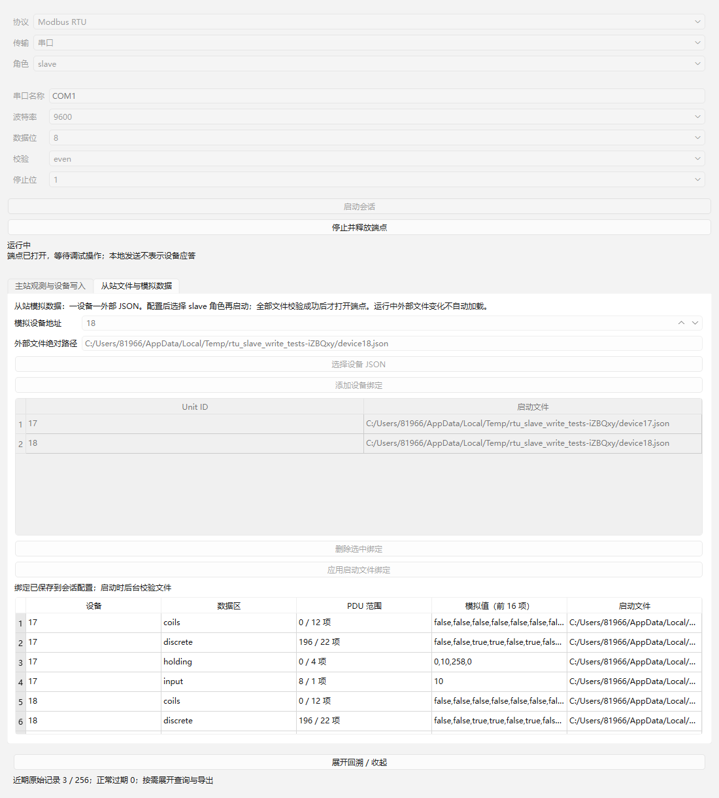

# 07：RTU 从站写入与数据反馈验收

日期：2026-10-22。独立 worktree `.worktrees/rtu-slave` / 分支 `codex/rtu-slave`，前置共享基线 `e0d3ce8`，包含已验收 04、06 和 11。读取本项 issue、正式规格、实施索引、AGENTS 及既有领域/架构/接口/工具链约定，复用 04 写入 PDU 语义与 06 从站数据模型，未改变既定 Qt/LLVM-MinGW 架构。

## 实现

补齐从站 05/06/0F/10。公共 `write_pdu` 增加解码入口，解码后的值再次通过既有编码语义验证，统一单线圈 FF00/0000、uint16、多值数量/字节计数/范围约束。每条合法写请求先完整校验，再基于一致值快照一次替换目标设备的文档；成功后 dirty=true、revision 增加 1，随后生成正常回显应答。非法多值不会部分改值，未知字段保留，离散输入/输入寄存器不会被写入。

单播仅改变指定 Unit。广播地址 0 的四种写命令不应答，按真实总线上独立从站语义分别校验各设备；每个合法目标整体提交，不具备相应范围的设备保持原数据，消息列出 updatedUnits / rejectedUnits。错误广播也不应答。此行为依据 [Modbus 串行规范 V1.02 §2.1](https://www.modbus.org/file/secure/modbusoverserial.pdf) 的广播写入与无响应规则；各设备独立范围的处理属于本项目模拟模型的明确实现选择。

本地应答发送失败不会撤销已经执行的写入；失败和来源仍保留。上次应答尚未结束时的新请求被明确拒绝且不改值，不建立无限等待队列。分块的多写请求按实际字节计数保守组装，不因主机交付延迟把首 8 字节当成完整请求。

插件的模拟数据表继续以 200 ms 批量刷新：外部主站写入后同一数据模型即时可查，界面及后续读取看到相同值。不会自动保存 JSON；磁盘保存、运行编辑和未保存保护由 08 实施。未新增宿主协议分支或 SDK 接口。

## 复现及结果

沿用 Windows x64、Qt 6.12.0 LLVM-MinGW、Clang 22.1.7、C++17、CMake 3.30.5、Ninja 1.12.1。Debug/Release 宿主及插件配套构建，未安装工具或修改全局 PATH。

```powershell
./scripts/verify.ps1 -EvidenceId 07
```

| 检查 | Debug | Release |
| --- | --- | --- |
| 配置/构建 | [通过](qt-llvm-debug/build.log) | [通过](qt-llvm-release/build.log) |
| CTest | [6/6](qt-llvm-debug/ctest.log) | [6/6](qt-llvm-release/ctest.log) |
| 生命周期 | [13 passed](qt-llvm-debug/test-results.txt) | [13 passed](qt-llvm-release/test-results.txt) |
| 主站读取 | [43 passed](qt-llvm-debug/read-results.txt) | [43 passed](qt-llvm-release/read-results.txt) |
| 主站写入 | [36 passed](qt-llvm-debug/write-results.txt) | [36 passed](qt-llvm-release/write-results.txt) |
| 从站 JSON 读取 | [29 passed](qt-llvm-debug/slave-results.txt) | [29 passed](qt-llvm-release/slave-results.txt) |
| 从站写入 | [25 passed](qt-llvm-debug/slave-write-results.txt) | [25 passed](qt-llvm-release/slave-write-results.txt) |
| 查询导出 | [10 passed](qt-llvm-debug/trace-results.txt) | [10 passed](qt-llvm-release/trace-results.txt) |
| SHA-256 | [清单](qt-llvm-debug/sha256.txt) | [清单](qt-llvm-release/sha256.txt) |

每配置 156 项 Qt Test 检查，含六套件初始化/清理共 12 项，行为行 144；0 failed / 0 skipped。构建产物由 build 忽略，不提交到 Git。06/07 公共可控传输、文件与时钟夹具抽到 slave_test_support.h，保留原有公开会话入口行为，不重复两套夹具。

## 验收映射

| 测试 | 外部行为 |
| --- | --- |
| fourFunctionsUpdateBeforeAcknowledgement，4 行 | 固定 05/06/0F/10 向量，严格核对请求后回显；本地 ACK 尚未完成时全部值已经生效，另一设备和只读区保持不变；dirty/revision 可查、来源区间可查，磁盘文件未改 |
| subsequentReadUsesWrittenSnapshot | 多寄存器写入 10/258 后功能码 03 返回相同数据；单线圈清零有效 |
| invalidWritesPreserveWholeDevice，8 行 | 非 FF00/0000、区间越界、零数量、跨尾址、尾部非法位、字节计数错误、123 上限越界等返回异常 02/03，完整会话快照不变 |
| broadcastWritesNeverRespond，4 行 | 四功能码广播都更新各合法模拟设备，revision/dirty 生效且从未发送应答 |
| broadcastInvalidAndIndependentRanges | 一个设备范围不足时保持其完整文档，其他合法设备整体更新，消息列出拒绝目标；非法广播不改数据也无应答 |
| busyOrDamagedRequestDoesNotWrite | 应答仍 pending 时新写不执行；坏 CRC 与未知 Unit 无写入 |
| responseFailureDoesNotUndoWrite | Unit 18 写入后本地应答被通道拒绝，Unit 17 保持不变，Unit 18 的值和 revision 仍保留，推进时间无重执行 |
| maximumLegalMultipleWrites，2 行 | 1968 线圈与 123 寄存器的 255 字节 RTU 请求均合法，正常应答及所有值一致 |
| widgetReflectsExternalWrite | 原生 Widgets 启动两个从站后接收外部可控请求，Unit 17 表格显示 0,10,258,0，Unit 18 仍为 99,99,99,99，实际发送正常回显 |

PDU 语义依据 [Modbus 应用协议 V1.1b3 §6.5/6.6/6.11/6.12](https://www.modbus.org/file/secure/modbusprotocolspecification.pdf)，固定 CRC 在实施时独立预计算，测试不调用产品编码/解码器生成预期数据。主要入口仍为 DebugSession.start/snapshot/poll/messages/traces；只在底层注入传输、时间和临时文件。没有窥视私有缓冲区或锁。

## 界面证据

实际 Windows Qt 测试窗口抓图，使用可控传输，已目视确认中文及 Unit 17 写入后数据可读；表格可滚动查看其他设备。Release 保存同名截图。



## 审查与限制

实施者检查公共 PDU 语义、按设备隔离、整体生效后应答、错误写入无部分变化、广播无应答及原始来源保留；补充本地应答失败不回滚与最大合法数量回归。最初测试夹具将合法 Unit 18 向量误当损坏请求，实际正确更新 Unit 18，已改成未知 Unit 19 并另加合法 Unit 18 隔离测试；最终完整 Debug/Release 重新通过。共享测试头首次编译补齐显式 QCoreApplication include。整体 Standards / Spec 审查由集成分支统一完成。

本项没有真实串口/独立硬件主站互通结论，可控请求及规范向量不能替代 13。Windows 接收聚合与逐字节物理间隙限制沿用 06 记录。没有启动 13–19、实现自动写重试或自动文件保存；08 将接续未保存修改的保存/放弃/取消与运行编辑。
