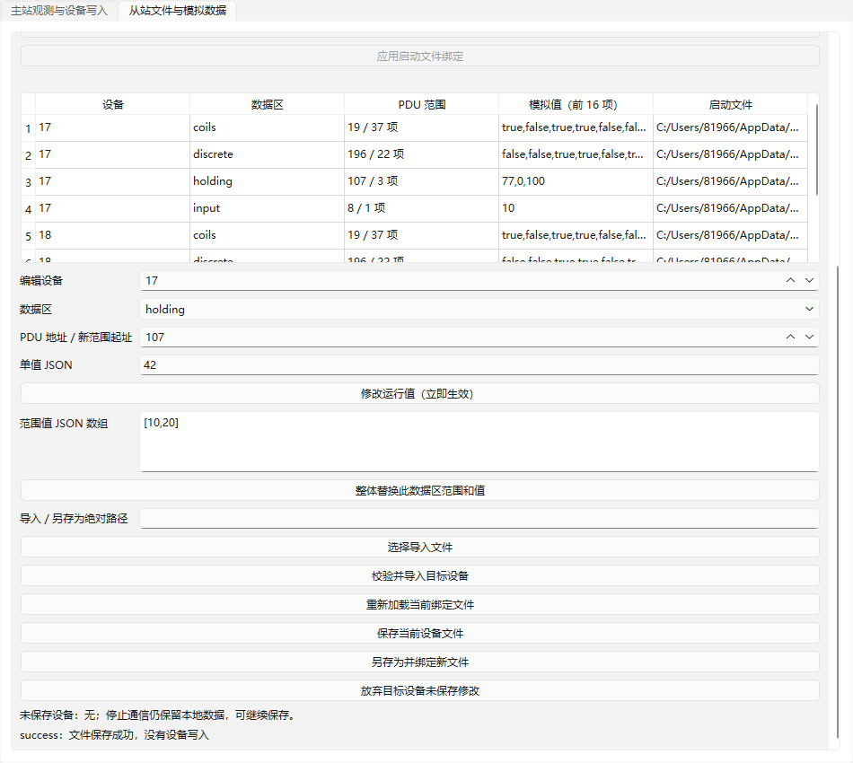

# 08：运行数据编辑、导入与保存验收

日期：2026-10-22（Asia/Shanghai）。前置 06 已按 `dd39760` 验收；本独立 worktree `rtu-data-edit` / 分支 `codex/rtu-data-edit` 复用 01–07、11 与 SDK5 组合基线。读取正式规格、当前实施索引、AGENTS、领域与 issue 约定、相关 ADR、接口契约及工具链说明后实施。

## 交付与接口

Modbus 插件提供 `slave-edit-value`（unit/area/address/value）、`slave-replace-area`（unit/area/start/values）、`slave-import`（unit/path/decision）、`slave-save`（unit，可选 path 另存为）、`slave-discard`。所有操作经过公开 `DebugSession.submit/operation/snapshot`，文件操作不发送设备写入。

编辑与范围替换先完整校验，再整体交换目标设备文档；主机事件上下文串行执行，每条请求看到一致版本。导入在后台读取和校验，完成时核对目标 revision；期间有新修改则拒绝替换，旧数据与绑定保留。导入成功后绑定导入文件，可继续编辑。保存捕获一致文档与 revision，使用 QSaveFile 写回或另存为；成功才更新绑定和保存基线，保存期间的新修改仍为 dirty。失败保留数据、绑定和修改状态。未知 JSON 字段保留。

SDK 显式升级 6：通用 LocalState 声明本地动作、未保存/繁忙状态与停止后保留能力；后台值任务全进程最多 4 项，无无限等待队列，宿主持有协议与 DLL 租约，完成回到会话上下文。停止释放通信端点并结束通信操作，从站运行数据保留供离线编辑/保存，本地文件操作可以完成；主站停止行为仍沿用既有实现。新启动必须重新读全部外部文件，不能用保留数据兜底。

替换、重新加载与关闭前，插件界面提供保存/放弃/取消。无界面的 API 在有未保存数据时拒绝重新加载，调用者需显式保存或放弃；文件作业繁忙时拒绝重载。取消重载不撤回已经明确提交的文件保存。界面显示未保存设备，编辑/文件区域可滚动。

## 环境与复现

Windows x64、Qt 6.12.0 LLVM-MinGW、Clang 22.1.7、C++17、CMake 3.30.5、Ninja 1.12.1；产品、SDK 与插件配套 Debug/Release。复用既有安装，仅子进程 PATH，无安装或全局设置修改。

```powershell
./scripts/verify.ps1 -EvidenceId 08
```

| 配置 | 构建与测试 | Qt Test |
| --- | --- | --- |
| Debug | [配置](qt-llvm-debug/configure.log)、[构建](qt-llvm-debug/build.log)、[8/8 CTest](qt-llvm-debug/ctest.log) | 181 passed、0 failed、0 skipped |
| Release | [配置](qt-llvm-release/configure.log)、[构建](qt-llvm-release/build.log)、[8/8 CTest](qt-llvm-release/ctest.log) | 181 passed、0 failed、0 skipped |

每配置包含生命周期 13、四区读取 43、轮询 16、主站写 36、从站读 29、从站写 25、回溯 10、编辑文件 9；总数含 8 个套件各自初始化/清理 16 项，实际行为检查行 165 项。各套件原始 `*-results.txt` 与产物/证据 SHA-256 均位于对应配置目录。构建产物不入 Git，01/02 及其他已验收目录不覆盖。

## 验收映射

| 条件 | 公开入口证据 |
| --- | --- |
| 编辑立即生效、独立设备、原子范围 | `editAndRangeAreImmediateAndIsolated` 修改 Unit17 保持寄存器后实际请求得到 42，Unit18 仍 111；越界替换和位类型错误不改数据，65535 地址范围可接受；编辑本身无发送 |
| 校验失败保留、导入后编辑 | `importValidationDecisionsAndBinding` 验证未知版本失败、needs-decision/cancel、无效导入保留整份文档/绑定/dirty，保存再导入只换目标设备、绑定新文件且后续可编辑，拒绝共享设备文件 |
| 保存失败、另存为、外部启动规则 | `saveFailureSaveAsAndStoppedData` 验证缺目录失败、unknown 字段往返、成功另存为；停止后仍可编辑；dirty 时拒绝重启，显式放弃后重新读文件，删除启动文件仍阻止通信 |
| 保存与新修改一致性、通信继续 | `saveSnapshotDoesNotClearNewEditsAndCompletesAfterStop` 可控后台任务捕获 42，期间编辑 99；文件是 42、运行是 99 且 dirty；第二次保存排队时仍处理读取并应答 99，停止后本地保存完成且 dirty 清除 |
| 导入不能覆盖新修改 | `importDuringEditDoesNotOverwriteNewData` 保持读文件任务未完成，编辑当前数据，随后完成导入返回 file-error，保留新值和旧路径 |
| 启动配置不可被旧模型覆盖 | `changedStartupConfigCannotBeOverwrittenByOldModel` 验证 dirty 时拒绝隐式配置变更，显式放弃后应用新绑定并撤下旧模型，旧保存被拒绝，新字段保留、重启读取 777；guard 期间嵌套启动被拒绝 |
| 实际 Widgets 流程与提示 | `widgetEditSaveAndReloadCancel` 选择从站页、修改并保存；重载前点击取消保留 77，再实际点击保存按钮完成重载；生成 [界面截图](qt-llvm-debug/slave-edit-save-controlled.png) |

## 审阅、修复与限制



首轮测试发现 RtuSession 未透传从站 LocalState，导致停止后模型未保留；补充转发后回归通过。界面测试最初用 QMessageBox.done 模拟保存，而 Qt 静态 question 按实际点击按钮取值，因而视为取消；测试改为真实按钮点击，没有削弱保存行为断言。之后加滚动容器、未保存状态显示与 guard 重入保护，最终两配置重新执行。整体 Standards / Spec 独立审查由集成分支完成并回写总验收。

独立专项审阅另发现 P2：停止后配置变更与旧模型并存，保存旧模型可能写回过时启动配置。已改为配置更新先保护未保存数据，再撤下旧模型，新增公开接口回归；原审阅者只读复核关闭，专项剩余发现 0。修改启动配置后，需重新启动校验新文件才能使用对应本地模型。

后台文件准备、文件作业和导出各有独立并发上限。单设备文档 4 MiB、会话 16 MiB、最多 32 个设备，沿用 v1 格式；容量保护不代表硬件吞吐保证。保留的最近保存文档用于显式放弃修改，不作为下一次启动文件缺失时的替代来源。文件读写为实际临时文件测试，慢任务由可控执行器保留来验证调度；不声称断电持久性或异常终止时仍可保存未提交修改。

所有成功通信为可控传输及真实协议 DLL，硬件串口、USB 聚合与独立对端未验证；13 仍等待真实硬件条件，未启动 14–19。
