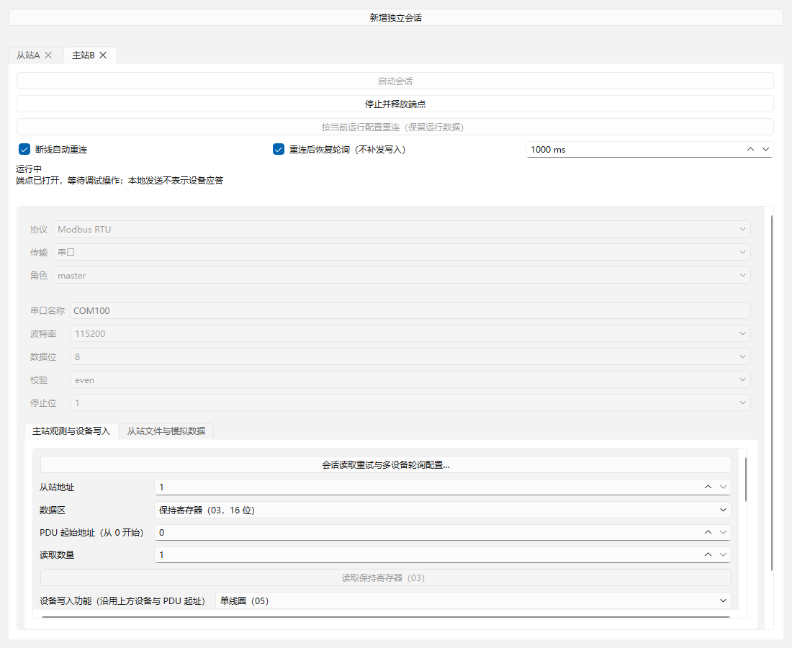
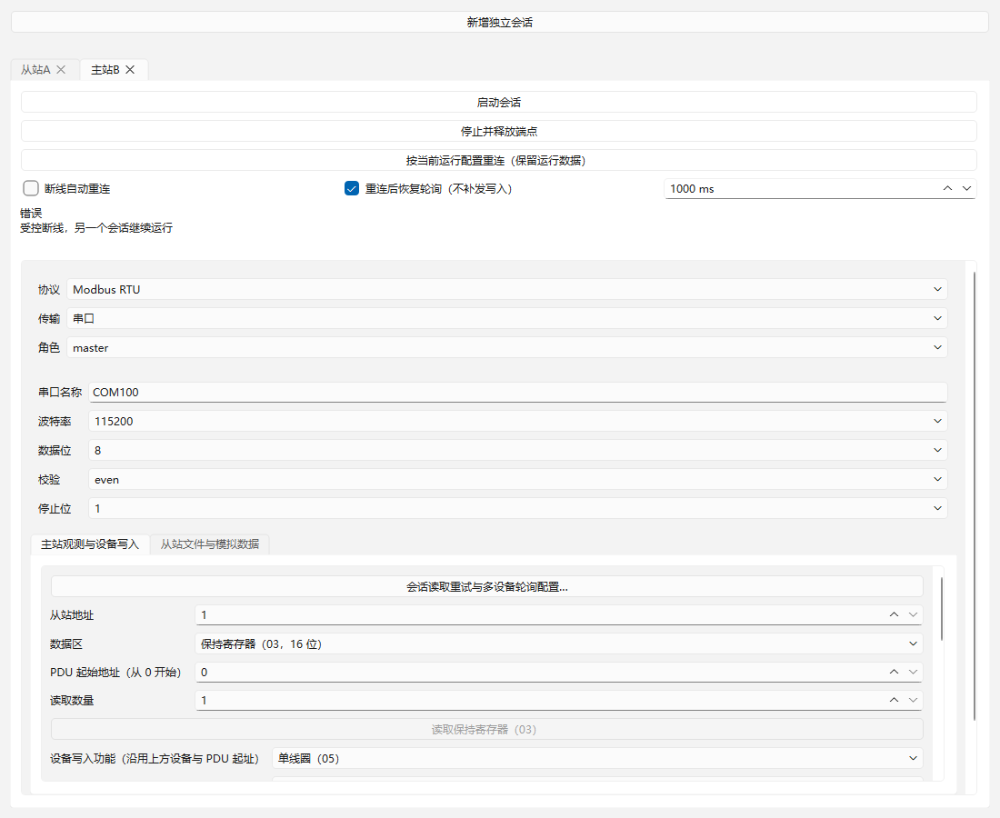
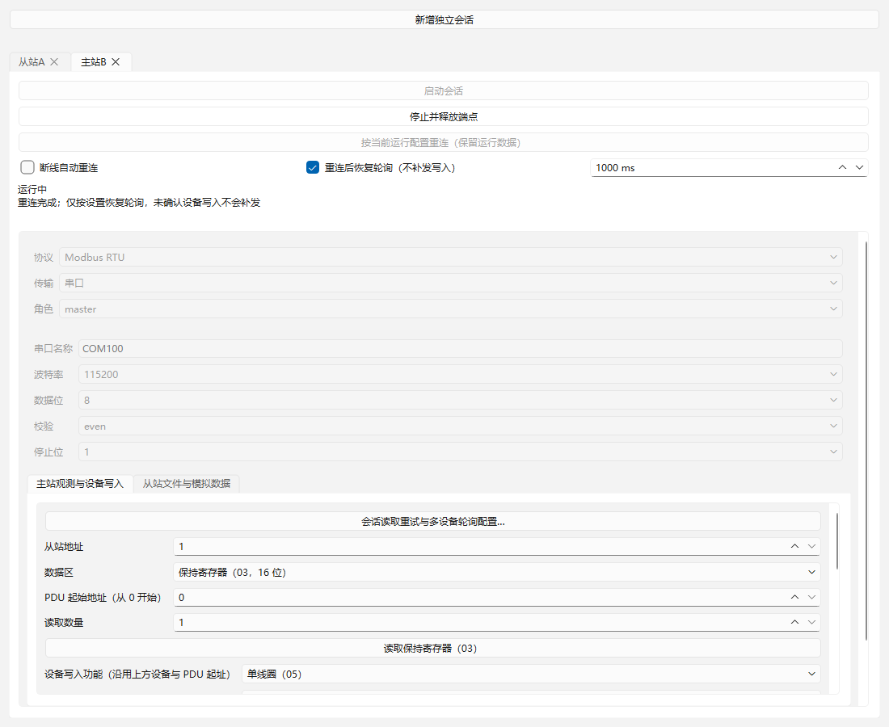
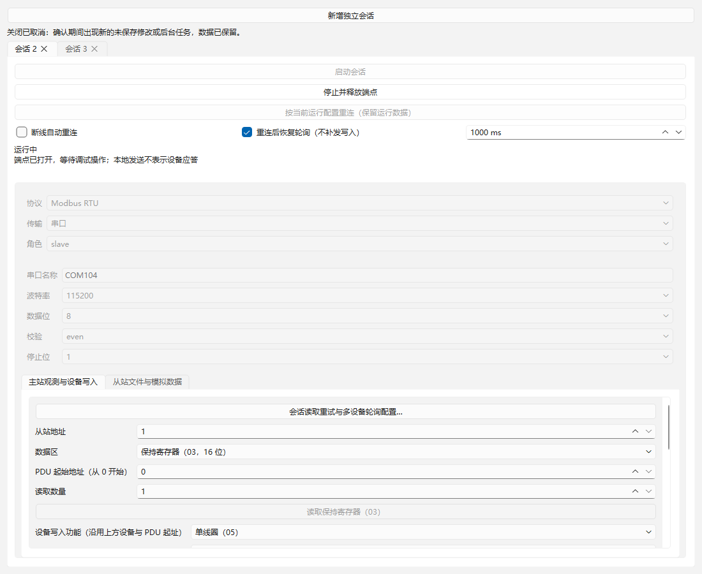

# 09：多会话与断线恢复验收

日期：2026-10-22（Asia/Shanghai）。范围仅 [09](../../issues/09-parallel-sessions-recovery.md)。独立worktree `rtu-master`、分支 `codex/rtu-master`；先合入含05/06/07的 `bada975`，再合入最终08集成 `5b4c37e`。01/02沿用原提交与验收，未重复实施。已读取AGENTS、本地issue/领域约定、规格、架构、接口契约、当前实施索引和工具链说明。

## 交付流程

工作台提供多个独立会话标签页，每页拥有DebugSession、配置、协议视图、记录和启停入口，共用插件注册表与规范化端点互斥。默认首个会话保持既有流程；可新增和关闭，软件保护上限16页。启停/重连/状态按钮固定在页面上方，端点配置与协议内容滚动；主站和从站数据页仍分别显示。关闭会话、窗口或切换协议前检查未保存和忙碌状态，取消保留原模型/视图；析构强制释放。

公开 `Workbench` 提供 `sessionCount/session/addSession/closeSession/sessionConfiguration/currentSessionIndex/selectSession`。`sessionConfiguration(index)`收集尚未启动页面的端点、协议、角色字段与运行发布配置；仅查询session.config不能取得尚未提交的页面编辑。

`SessionConfig.recovery`为宿主通用配置，支持布尔 `autoReconnect`（默认false）、布尔 `restorePolling`（默认true）与整数 `intervalMs`（10..60000ms，默认1000）。手动重连按原运行配置复用端点；要应用编辑后的连接配置，停止再启动。自动恢复只有一个到期时间，不积压定时任务，停止或新配置撤下模型会取消旧恢复。

断线终结全部未完成通信操作，保留提交状态及不确定提示；本地文件操作继续归属原协议实例。重连重新申请端点、创建后端并验证占用，只恢复允许的轮询，不补发排队操作或已提交写入。关闭恢复轮询后仍可手动读取。初次打开失败可按设置自动重试，不重复准备外部数据文件。

## SDK与生命周期

SDK7/IID/构建指纹配套升级，追加通用recovery字段与 `connectionLost/connectionRestored`。宿主端点事件按connection generation过滤；协议发布、调度、后台文件完成和配置发布按protocolRun租约过滤。重连不会替换协议实例，旧端点回调不能操作新连接；手动停止/新启动仍遵循原运行生命周期。

RTU主站中断时清理当前/排队通信、部分帧与本地发送状态，保留轮询配置和来源不确定历史，恢复只重新启用允许的读取调度。从站仅清理通信缓冲与待发送应答、重新激活原模拟数据；不调用prepare，不热加载JSON，后台保存任务继续。已有RTU物理迟到的不可辨识性仍公开标记，不能声称重建连接证明新采样。

保留08的LocalState、后台任务/DLL租约、未保存保护、configure撤下旧模型和resolveUnsaved重入保护；09另外在新配置撤下模型时清除旧自动恢复到期状态，避免对已经不存在的旧运行反复尝试恢复。

## 环境与复现

Windows x64；Qt6.12.0 LLVM-MinGW、Clang22.1.7、C++17、CMake3.30.5、Ninja1.12.1。未安装工具或修改全局PATH；Qt自身release，产品/协议/传输/夹具按相同Debug或Release配套构建。可选Vulkan headers缺失未阻止Widgets构建。

```powershell
./scripts/verify.ps1 -EvidenceId 09
```

| 配置 | 配置/构建/CTest | Qt Test结果 |
| --- | --- | --- |
| Debug | [配置](qt-llvm-debug/configure.log)、[构建](qt-llvm-debug/build.log)、[9/9通过](qt-llvm-debug/ctest.log) | 生命周期13、读取43、轮询16、写入36、从站读取29、从站写入25、数据编辑9、回溯10、恢复14；195 passed、0 failed、0 skipped |
| Release | [配置](qt-llvm-release/configure.log)、[构建](qt-llvm-release/build.log)、[9/9通过](qt-llvm-release/ctest.log) | 同上195 passed、0 failed、0 skipped |

上表为2026-10-23审查修复后的最终重验：195包含9套件初始化/清理18项，实际行为检查行177项。每配置的 `*-results.txt` 保存详细结果，`sha256.txt`保存产物与证据哈希；01–08及11原证据未覆盖，构建产物保持忽略。命令最终退出0。

## 验收映射

| 条件 | 公开入口外部证据 |
| --- | --- |
| 并行主从与冲突 | `parallelMasterSlaveAndConflictingEndpoint`：COM91主站与COM92从站并行完成固定向量；COM91与Windows别名冲突明确拒绝；主站断开后从站继续应答；另一会话占用已释放端点时重连仍被拒绝，释放后可重连 |
| 自动恢复、旧事件隔离 | `automaticReconnectResumesPollingAndRejectsOldCallbacks`：未到10ms不重开，到期重建后恢复读取；旧端点sent/RX不结束新操作，queued写入结束且全部新发送仍只有03；状态和connection-restored记录可查，stop取消恢复 |
| 写入不补发 | `sentWriteIsUncertainAndNeverReplayed`：本地发送完成但设备未确认时断线，操作transport-error且uncertain；重连后不再发送，人工新写入形成新ID |
| 选择暂停轮询 | `manualReconnectCanLeavePollingPaused`：不自动重连；手动重连后关闭恢复选项，等待远超周期也不发送，人工读取仍可提交 |
| 保留从站运行数据 | `slaveReconnectPreservesEditedDataDespiteDeletedStartupFile`：运行值改77后断线，删除启动文件，重连仍为Running、快照及脏状态相同，固定03请求返回77；旧回调中的单字节噪声不污染新解析 |
| 后台文件跨连接完成 | `backgroundSaveCompletesAcrossConnectionEpoch`：可控后台保存待完成时断线，localOnly操作不取消；重连同实例后完成原保存，文件值77、配置绑定成功写回，证明发布未被错误的连接代次拦截 |
| 多次启停与资源释放 | `repeatedLifecycleReleasesEndpointAndBoundsAutomaticAttempts`：20次启动/断线/重连/停止，其他会话每次均可复用端点；间隔内不会产生大量重开，stop后不重开 |
| 配置与生产计时 | `invalidRecoveryPolicyDoesNotOpenEndpoint`拒绝错误布尔/间隔；`qtTimerRetriesInitialOpenFailureWithoutManualPoll`经过生产Qt定时器自动恢复初始打开失败并开始轮询；`newConfigurationCancelsOldRecovery`证明撤旧模型后不再重开旧端点 |
| 工作台完整流程 | `workbenchCreatesParallelTabsAndProtectsDirtyClose`：两页主从运行，dirty关闭/窗口关闭取消保留数据；另一页断线、点击重连恢复，取消未保存后关闭只释放对应页，余页继续；最终关闭窗口停止剩余会话。保存原生截图 |

测试经DebugSession公开控制与查询及Workbench公开入口；可控传输/时间仅替换I/O和时钟，继续使用实际DLL。协议页明确命名protocolTabs、会话容器sessionTabs，既有06/07界面测试按公开控件身份选择，避免误选外层标签页。

## 界面证据

原生Windows Qt窗口、可控端点，非真实硬件连接。Release保存同名截图。目视检查窗口1100x900、会话标签、固定启停/重连、恢复选项和中文错误/恢复状态可读；下方内容可滚动，常用按钮不随长协议视图移出屏幕。







## 审查与限制

实施者核对代次/运行租约、队列清理、不补发写入、从站数据和文件作业保留、未保存保护及资源释放。首次回归发现连接失败后把端口编辑也禁用了，破坏旧UI错误修正路径；已恢复错误状态可编辑，重连按钮明确按原运行配置，改配置用停止/新启动。首次界面尺寸因长从站编辑页扩展到屏幕之外，已将操作按钮固定并将其余页面内容放入滚动容器。最终改动后双配置全量重新通过。整体Standards/Spec独立审查由集成分支统一记录。

没有打开现有真实设备或连接独立硬件对端。本机串口枚举不证明拓扑；真实驱动拔插、独占访问冲突、线路回显/方向控制与硬件时序仍由13验证。应用按规范化COM名称互斥，不能从两个不同串口名判断它们是否接在同一物理RTU总线上；实际拓扑必须遵守单主站约束。16页是软件资源保护上限，不是已实测持续容量。模拟和固定向量不替代13，不启动14–19。


## 2026-10-23：关闭窗口期间再次修改的审查修复

父级专项审查发现P2：逐页未保存确认会运行模态事件循环，较早已保存或丢弃的会话，可能在后续页确认期间接收到新修改。原关闭路径结束全部确认后立即停止并销毁模型，会遗漏这次新数据。

新增公开只读 `DebugSession::hasUnsavedOrBusy()`，读取通用LocalState。窗口完成全部确认后，无事件泵再次检查所有会话；任何dirty或busy均拒绝关闭、切到对应页并显示“数据已保留”，不重复弹出确认，也不停止现有连接。检查全部通过后才同步停止会话。后台准备期间不调用未完成模型的LocalState。

公开Widgets回归 `windowCloseRechecksEarlierSessionAfterLaterGuard` 启动两个独立从站：A先丢弃111变为clean，B确认回调通过公开slave-edit-value把A修改为999，再丢弃B的222。窗口关闭返回false，A999和两个Running会话均保留；B为clean；再次明确关闭可正常停止全部会话。此例通过合法本地编辑覆盖与设备写入共用的dirty保护边界，无需访问私有容器。

中断前的验证进程已完成，恢复后检查无残留cmake/ninja/ctest进程；复核最终Debug/Release均CTest9/9、每配置195 passed、0 failed、0 skipped，恢复套件14项。证据及全部产物SHA256逐条复核0差异。再次审查确认最终检查至stop之间没有事件泵，拒绝关闭保留模型、视图和连接，未引入重复模态确认。



已目视Debug截图中的关闭取消提示与Running状态；Release同名截图一并保存。原2026-10-22验收和issue评论保留历史日期，本节追加记录本日修复。
