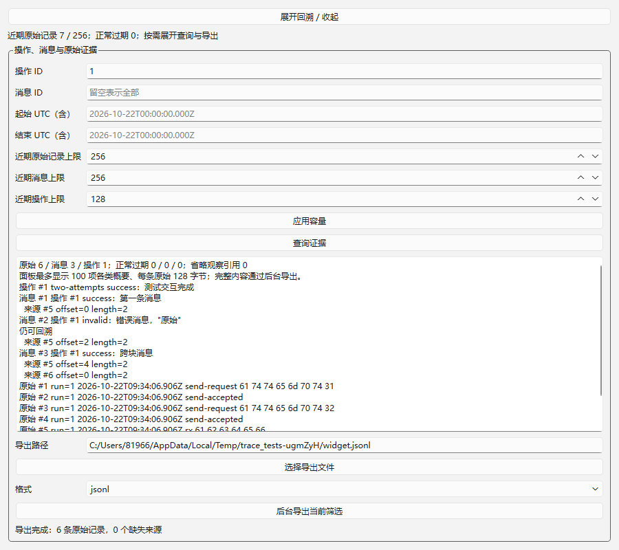

# 11：回溯查询与后台导出验收

日期：2026-10-22，Windows 11 x64。实施 worktree：`.worktrees/rtu-records`，分支 `codex/rtu-records`；代码基线 `abb5169`，其中包含 01/02 提交和既有规格/设计/工具链。01、02 不重复实施，仅运行回归。范围仅当前索引的 [11](../../issues/11-trace-query-export.md)，没有提前实施磁盘留存或硬件阶段。

## 实现与公开入口

- `DebugSession.configureTrace(TraceLimits)` 设置原始、消息、操作缓存；默认 256/256/128，上限 8192/8192/1024。原始每块最大 4096 字节、每操作观察引用最多 512，超过的数量仍可查询。容量非法或小于未完成操作数时拒绝，未完成操作不被淘汰；队列已满时 `submit` 返回 0。
- `queryTrace(TraceFilter)` 按操作 ID、消息 ID、UTC 起止（含边界）查询。UTC 筛选选中的消息会补齐相关来源；关联操作的观察窗口也会保留。观察窗口并不表示协议已确认归属，RX 的 `operationId` 仍为 0。
- `Message.sourceRanges` 表达记录 ID、offset、length，同一块允许多消息，一条消息允许多块。保留 `sources` 列表兼容现有视图。Modbus 按实际接收块添加区间，不把缺少可信边界的拼接数据伪装成多个合法 RTU 帧。
- `TraceRecord.metadata` 保留传输实际报告的通用元数据，不制造 CAN 信息或硬件时间。消息增加 UTC 和单调观测时间。SDK ABI 显式升级为 3，协议和传输 IID 均为 `/3.0`，构建指纹同步；配套重新编译 DLL。
- `exportTrace(filter,path,format)` 在调用上下文捕获有界值快照，后台使用 QSaveFile 原子提交 CSV/JSONL。快照独立于会话及其缓存，捕获后淘汰或销毁不会改变已选内容。全进程最多 4 个后台导出，预留名额后才复制快照，超额立即返回失败，无待处理队列。
- JSONL schemaVersion 1 使用字符串存储 64 位 ID/时钟值，包含 manifest、trace、message、operation、source；保留原始字节、元数据、精确来源区间和结果。来源状态为 available/expired/unavailable/invalid-range；缺失来源无伪造字节。CSV 为带引号的概要与来源状态，双引号/换行正确转义。
- 通用 `TracePanel` 有概要、主动展开、操作/消息/UTC 筛选、三类容量设置、路径选择与后台导出。面板最多绘制每类 100 项和每原始记录前 128 字节，完整内容通过导出获取，避免逐字节无限绘制。

## 环境与复现

复用 Qt 6.12.0 LLVM-MinGW、Clang 22.1.7、C++17、CMake 3.30.5、Ninja 1.12.1。未安装工具或改全局 PATH。执行 `./scripts/verify-11.ps1`，保留独立证据目录，不覆盖 01/02。

| 验证 | Debug | Release |
| --- | --- | --- |
| 配置/构建 | [配置](qt-llvm-debug/configure.log)、[构建](qt-llvm-debug/build.log)成功 | [配置](qt-llvm-release/configure.log)、[构建](qt-llvm-release/build.log)成功 |
| CTest | [3/3 通过](qt-llvm-debug/ctest.log) | [3/3 通过](qt-llvm-release/ctest.log) |
| 生命周期回归 | [13 passed / 0 failed](qt-llvm-debug/test-results.txt) | [13 passed / 0 failed](qt-llvm-release/test-results.txt) |
| 首次读取回归 | [36 passed / 0 failed](qt-llvm-debug/read-results.txt) | [36 passed / 0 failed](qt-llvm-release/read-results.txt) |
| 新增回溯套件 | [10 passed / 0 failed](qt-llvm-debug/trace-results.txt) | [10 passed / 0 failed](qt-llvm-release/trace-results.txt) |
| SHA-256 | [产物与证据](qt-llvm-debug/sha256.txt) | [产物与证据](qt-llvm-release/sha256.txt) |

每配置共 59 项 QtTest 检查，含三个套件的初始化/清理 6 项。新增 8 个行为检查：多对多区间/元数据/两次发送记录、真实 Modbus 分块来源、缓存过期和引用省略、时间/身份筛选、导出期间淘汰与会话销毁、缺失与 CSV 转义/文件失败、后台并发上限、原生 Widgets 查询与导出。测试主入口是 DebugSession 公共操作/查询与可控传输；通用来源关系额外使用独立测试协议 DLL，放在 trace-fixtures，产品插件目录只有 Modbus/serial，不新增产品支持组合。该测试协议只证明记录契约，不宣称为独立 Modbus 对端或真实重试实现。

## 界面与审查

Debug、Release 均保留原生 Qt 截图；已目视检查中文、精确字节区间、原始十六进制和导出完成状态可读。截图输入为可控流量，不是硬件证据。

实施自审及集成代理增量检查修复了两个资源问题：后台调用原本可堆积线程/快照，现为复制前全局限额；查询原本循环重复线性寻找来源，现用一次构建的索引，并限制概要绘制。两者均在最终双配置执行前修复。整体 Standards/Spec 独立审查由 03–12 集成阶段统一执行，不能把此处自审冒充最终独立审查。

## 未覆盖边界

- 磁盘自动记录、跨重启查询、轮换、慢后端与过载统计属于 12；本项只有主动导出，正常缓存过期与不可用来源不会被当作过载丢失。
- 没有使用真实串口、CAN 或独立 Modbus 设备；硬件时间与吞吐承诺仍由 13 验证。RTU 读取规则沿 02 的保守时间语义。
- 查询捕获在会话所属上下文串行执行，数据规模由公开容量上限约束；文件写入在后台执行。进程被强制终止不保证导出完成；成功结果只在 QSaveFile 提交完成后报告。任意慢磁盘的持续吞吐不在本项保证范围。
