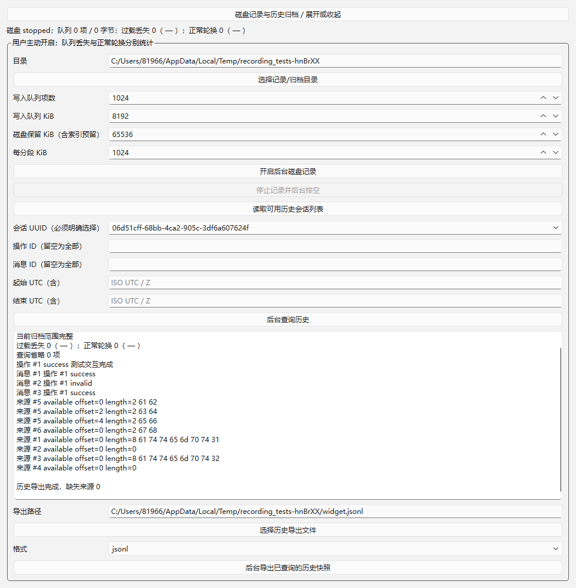

# 12：有界磁盘记录验收证据

实施始于 2026-10-22，续行验收记录日期为 2026-10-23（Asia/Shanghai）。原始日志保留工具实际运行时间。范围仅当前 [12](../../issues/12-bounded-disk-recording.md)，前置 05/11 已通过提交与验收记录核验；不把 ready-for-agent 当作完成状态。未启动 13 或后续阶段。

实施分支 `codex/rtu-records`，独立 worktree `.worktrees/rtu-records`；先同步 05/06/11 集成基线 `4d04742`，实现提交 `522336e`，再以 `bd6e3f6` 合并已验收的 07/08 与 SDK6。保持 Qt/LLVM-MinGW、统一通道、插件职责与本地有界记录架构。格式与容量规则见 [磁盘记录说明](../../recording-format.md)。

## 实现

`DebugSession.startRecording/recordingStats/stopRecording` 提供主动开启、状态与异步排空入口。写入器在独立后台池按批消费，待写队列同时限制项数和真实序列化字节数；本地留存限制数据总字节数和分段数量。近期缓存沿 11 单独配置。丢失计数/首末 UTC 在队列之外维护，不需要把提示再塞进满队列。

每个会话 UUID、每次记录 UUID 和会话内稳定 ID 共同区分身份。原始记录在完整补齐 metadata/idleBeforeUs 后入队；消息、来源区间、操作各阶段及终态一并持久化。SDK6 的 localOnly 和 working 等本地工作流语义保留，不因通信停止改成错误的网络取消。

后台 `queryArchive` 通过两遍有界扫描恢复消息/操作及实际来源，按会话 UUID、操作、消息与 UTC 筛选，区分正常轮换 expired、过载 lost 与无法证明的 unavailable。捕获后的快照复用 CSV/JSONL 后台导出，带目录级 retention 完整性摘要。查询预算、扫描中轮换、损坏与来源缺失都有明确标记。

Widgets 提供目录选择、队列/磁盘/分段容量、开启与停止、历史会话选择、筛选及导出入口。概要按 200 ms 批量刷新；历史面板每类最多显示 100 项，不逐条刷新通信事件。

## 环境与执行

Windows 11 x64；Qt 6.12.0 `llvm-mingw_64`、Clang 22.1.7、C++17、CMake 3.30.5、Ninja 1.12.1，均复用已有安装。没有安装新依赖或修改全局 PATH。执行：

```powershell
./scripts/verify.ps1 -EvidenceId 12
```

| 检查 | Debug | Release |
| --- | --- | --- |
| 配置与构建 | [配置](qt-llvm-debug/configure.log)、[构建](qt-llvm-debug/build.log)成功 | [配置](qt-llvm-release/configure.log)、[构建](qt-llvm-release/build.log)成功 |
| CTest | [9/9 通过](qt-llvm-debug/ctest.log) | [9/9 通过](qt-llvm-release/ctest.log) |
| 12 新套件 | [20 passed / 0 failed](qt-llvm-debug/recording-results.txt) | [20 passed / 0 failed](qt-llvm-release/recording-results.txt) |
| 既有回归 | 181 项通过 | 181 项通过 |
| 合计 | 201 项、0 failed、0 skipped | 201 项、0 failed、0 skipped |
| 哈希 | [产物和证据](qt-llvm-debug/sha256.txt)，逐项重算 0 不符 | [产物和证据](qt-llvm-release/sha256.txt)，逐项重算 0 不符 |

总数包括 9 个 QtTest 套件的初始化/清理 18 项以及参数化行；不是 201 个独立测试函数。新增 20 项中，初始化/清理占 2 项，坏索引表含 7 行。

## 验收映射

| 条件 | 公开会话/API 行为验证 |
| --- | --- |
| 跨重启与身份 | `crossProcessRestartKeepsIdentitiesAndRelations` 两次启动实际子进程写同一目录，再从父进程查询：会话 UUID 不同，各自操作 ID 均为 1；操作 success、三条消息、跨块来源和导出字节不混合 |
| 满队列丢失 | `fullQueueKeepsIndependentLossAndLateSources` 强制阻塞后台批次，1000 次输入后队列项数/字节不越界，丢失计数及 UTC 范围可见；恢复后继续成功操作，归档与 JSONL 明确 source=lost |
| 字节预算独立 | `byteQuotaRejectsWithoutBlockingProtocolInput` 将字节队列设为 1 KiB、项数设为 8192；4 KiB 原始输入不被队列阻塞，近期字节仍可查，磁盘事件明确丢失 |
| 正常轮换 | `rotationBoundsDiskAndMarksExpiredSources` 注入 1200 块，在 256 KiB 管理预算下轮换、无过载丢失；统计正常轮换范围，后续消息的旧来源为 expired |
| 通信优先 | `pollingAndExportContinueWithBlockedDisk` 使用真实 Modbus 插件、可控传输与时钟，后台写入完全阻塞时完成 334 次发送，并继续轮询与导出；缓存上限 32、队列上限 8 均保持，记录丢失 3362 事件仍可见 |
| 元数据与终态 | `metadataPersistedAfterCompletionAndStop` 验证 RX 实际元数据、idleBeforeUs=0、发送 attempt 与 success 操作终态；停止通信后仍可从归档恢复 |
| 本地操作语义 | `localOnlyFlagSurvivesArchive` 经公开提交与停止查询，归档保留 localOnly=true 与已成功本地操作 |
| 失败隔离 | `lockedOrInvalidDirectoryOnlyDisablesRecording` 覆盖非法容量、目录独占冲突、缺失索引，记录失败后协议操作仍完成 |
| 损坏与外部删除 | `deletedAndCorruptSegmentsAreExplicit` 查询缺失分段、非 JSON 内容均显式标记，不声称完整 |
| 索引严格校验 | `invalidIndexNumbersNeverLookComplete` 7 行覆盖 size 乱码/负值/缺失、丢失计数乱码/负值、轮换计数溢出/错误类型；查询拒绝，重新开启记录拒绝且原索引字节不变 |
| 孤儿恢复 | `orphanRotationKeepsIndexReadable` 创建未入索引的超预算孤儿段；轮换后索引可查询、archiveGap=true、complete=false，不捏造 UUID/时间区间，不删除无关文件 |
| 界面 | `widgetRecordingAndArchiveExport` 在原生 Widgets 开启/停止记录、列出会话、查询来源并导出，生成截图 |

受控轮询的 Debug 墙钟处理为 151 ms，逻辑时钟推进约 5 s；该数字只说明此机器的可控测试处理结果，不是物理串口帧率、持续吞吐或目标设备能力承诺。Release 的实际运行数据见独立日志。

## 界面证据



Debug/Release 均保存原生 Qt 测试窗口截图。已目视检查中文、容量、会话 UUID、来源区间、字节及导出完成提示可读；输入为可控传输，不是实际硬件联调。

## 审查与修复

根集成代理增量审查发现并修复：切段 flush 未检查可能误报完整；索引数值转换可能将坏值当 0；孤儿轮换不能生成缺少身份/时间的精确范围。现检查每次 flush，并尽力写入 recordingError；写入器与查询共用严格索引验证；孤儿仅保留 archiveGap 和已知统计。坏索引和孤儿回归全部通过。

实施自测还修复读取最后一行的 maxSize 边界，避免丢掉末次操作终态；停止完成在释放目录锁之后报告，避免刚结束即重开/删除目录的竞争。查询额外限制三类对象的序列化规模，后台池与并发槽独立有界。最终全量结果是上述修复后的结果；整体 Standards/Spec 独立代码审查由 03–12 集成阶段统一记录。

## 实际边界

- 未连接独立设备、真实串口或 CAN；本项不替代 13 的真实互通、线路时序和持续负载验收。没有启动 13–19。
- 强制慢存储由批次 seam 控制，测试覆盖通信与有界队列协作；没有制造实际系统磁盘写满、驱动 flush 失败或断电。实际文件错误会显式禁用记录并保留界面错误，但文件系统完全不可写时不能保证错误标记也已落盘。
- 完成结果表示文件 flush/索引原子提交与关闭已返回，不构成硬件掉电持久性保证。未完整提交、孤儿或外部修改的历史不能被当作完整证据。
- 近期缓存正常过期、磁盘正常轮换、过载丢失和查询预算省略分开表达；区间摘要自身截断时保留计数与总时间范围，并降低无法证明的来源状态，不伪造原始字节。
