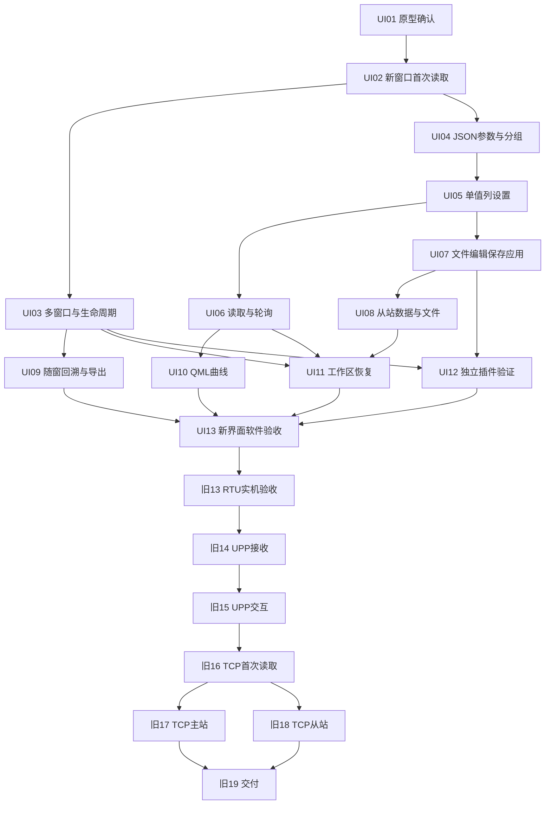

# 新界面与既有产品任务的综合拆分草案

日期：2026-10-23。

发布状态：2026-10-23 用户已按此确认发布综合任务，现见 [综合实施索引](implementation-plan.md)。以下保留发布前拆分原文及确认方案，作为任务来源；不表示任务已完成。

依据：[界面变更规格](spec.md)、[原产品规格](../multi-protocol-debugger/spec.md)、[旧任务索引](../multi-protocol-debugger/implementation-plan.md)、[界面访谈](../multi-protocol-debugger/ui-redesign-interview.md)。

## 综合原则与现状

- 旧 01–12 已完成，核对各任务验收项均无未勾选项，完成记录和软件验收证据继续有效。不得因为 UI 改动把协议与传输能力重新标成未实现。
- 旧 13–19 保留编号、原文件和历史；继续完成其剩余目标，补充新界面验收要求，不另造七份重复任务。
- 新增 UI01–UI13：实际文件拟在本功能目录的 issues 中按 01–13 编号；跨目录引用使用 UI 前缀或“旧”前缀，避免两个 13 混淆。
- 用户已确认测试以调试会话公开接口、可控传输和时钟为主要入口，补充真实 Qt 界面操作验收。原型通过与正式产品完成分开记录。
- 执行顺序建议为：原型确认 → 新界面 RTU 完整软件流程 → 新界面的 RTU 实机阶段验收 → UPP/CAN → TCP → 交付。硬件准备和资料收集可以提前，不越过产品实现阶段。
- 保持既有功能可运行，按功能切片逐步替换界面。只在首个消费该能力的切片中先补必要的公开模型/视图接口和兼容适配，不单列一个横跨全项目的“框架全部重构”任务。
- 本次只提出任务，不修改或关闭父规格，不把 to-spec 的 ready-for-agent 标签当作原型验收或任务完成。

## 已完成任务如何复用

| 旧任务 | 已有能力 | 本次工作及后继 |
| --- | --- | --- |
| 01、02 | 会话启停、串口通道、首次 RTU 读取 | UI02 接入新窗口；协议与端点行为复用。 |
| 03 | 四类 Modbus 数据区读取 | UI04 改为插件定义的逐参数表和 JSON 分组。 |
| 04 | 显式设备写入、不自动重试 | UI05 接入单值列编辑和行内设置。 |
| 05 | 多设备轮询、读取超时与重试 | UI06 提供选中项/组的可见入口和视图切换验证。 |
| 06、07 | 从站外部文件启动、读写应答 | UI08 接入从站参数表，保留数据与启动约束。 |
| 08 | 从站即时编辑、导入、保存和一致性保护 | UI07/08 拆开文件草稿、保存、应用和运行值操作。 |
| 09 | 多会话、恢复、未保存关闭保护 | UI03 接入多窗口生命周期；UI07/08 继续覆盖新增修改状态。 |
| 10 | 工作区、文件引用和插件缺失恢复 | UI11 加入窗口布局并验证新配置往返。 |
| 11、12 | 回溯、导出、有界缓存和磁盘记录 | UI09 在各调试窗口内呈现，不重建记录引擎。 |
| 已有插件和工具链基线 | 配套插件加载、Widgets、Qt/LLVM-MinGW | UI02 按需扩展最小视图契约；UI12 用独立示例插件验证主体边界。 |

## 新增任务：逐项可演示的完整流程

### 1. UI01：确认可操作原型的布局与关键流程

**Blocked by：** 无。已有原型和已确认规格可直接使用。

**交付：** 修正原型显示问题，实际走通多窗口、参数操作、文件保存/应用和 QML 曲线，由用户确认布局和关键交互，留下可供正式实现参照的截图、流程及反馈。

- 原型仅用模拟数据，不连接硬件；不把演示协议当成真实 UPP。
- 并排、浮动、记录随窗移动、单值列待提交状态、独立文件页和基础曲线均可操作。
- 明确记录用户接受与待改内容；编译或截图成功不能替代用户验收。
- 不把原型的临时 JSON、行数/曲线数量限制或界面内业务逻辑直接复制进正式产品。

**覆盖新规格故事：** 71；用于提前验证其他故事的展示方向，不代替其产品实现验收。

### 2. UI02：在新的调试窗口完成一次 RTU 读取

**Blocked by：** UI01。复用已完成的旧 01、02、03。

**交付：** 用户新建 RTU 主站会话、配置端点和设备，在正式调试窗口的通用参数表完成一次读取，并看到结果及该会话的基本通信记录。

- 必要的公开参数/选择访问和视图挂载能力先在本切片内补齐，再接真实会话、协议及传输路径；不以模拟业务替代。
- 框架模板由 Modbus 插件提供显示与操作内容，主窗口不写入 Modbus 组帧逻辑。
- 新窗口具备简明启停状态和独立连接配置入口；停止行为、端点释放及首次读取保持已有语义。
- 旧视图可经兼容入口继续使用，迁移中保持既有回归通过。

**覆盖新规格故事：** 2、16、18、19、24、35、36、68。

### 3. UI03：同时运行并管理多个可停靠调试窗口

**Blocked by：** UI02。复用旧 09。

**交付：** 创建同协议多个会话，在会话→设备导航中定位窗口，窗口可平铺、浮动、重新停靠，底部基本记录随所属窗口移动。

- 一个窗口对应一个会话，窗口内可添加/选择设备；显示上下文与运行状态不串用。
- 移动、最小化、折叠、页面和设备选择变化均不停止通信。
- 关闭停止对应会话，保留配置，重新打开后不自动通信；未保存提示取消时保留原状态。
- 先验证已有修改保护；后续 UI05/07/08 各自接入新增待提交或文件状态，最终由 UI13 组合验证。

**覆盖新规格故事：** 1、3–13、17、63。

### 4. UI04：加载 JSON 分组并按参数或地址读取设备

**Blocked by：** UI02。复用旧 03。

**交付：** 为设备加载参数 JSON，插件生成分组和参数行；有名称显示名称，无名称显示寄存器地址；无具名配置时可按数据区、起址、数量生成参数并实际读取。

- 明确正式参数定义、现有从站数据和工作区引用的关系及兼容策略，不能直接采用原型格式。
- 列、类型/单位/说明和分组来自插件解释，未分组参数进入默认组。
- 通过明确的加载/应用入口选择目标；无效配置保留原有效内容，不能在此切片偷偷加入“保存即应用”。
- 只实现本流程必要的读取与参数声明；编辑和保存放在 UI07，其他协议产品实现不提前。

**覆盖新规格故事：** 20、22、24–28、65。

### 5. UI05：在单值列编辑并明确设置设备参数

**Blocked by：** UI04。复用旧 04。

**交付：** 双击参数值编辑，待提交状态清晰，点击行内设置才发送，并正确呈现成功、异常或不确定结果。

- 新观测不能覆盖正在编辑或待提交的输入，也不能把草稿误标为设备观测值。
- 权限及校验由插件提供；未提交编辑、文件操作和本地发送完成不能冒充设备确认。
- 写入不自动重试；关闭、切换设备或替换数据时处理待提交值，不丢失既有结果证据。
- 使用可控输入验证编辑期间到达的新观测；完整轮询入口由 UI06 提供。

**覆盖新规格故事：** 29–35。

### 6. UI06：按选中项或参数组读取并持续轮询多个设备

**Blocked by：** UI05。复用旧 05。

**交付：** 在新参数表读取选中项、读取当前组，选择范围与周期开始/停止轮询；切换设备或分组后仍保持原目标采集。

- 明确选区与组读取目标，不把所有数据区或不同设备误合成一个请求。
- 沿用会话级读取重试、超时及总线调度；设备设置不进入轮询/自动重试。
- 用真实轮询更新验证 UI05 的待提交保护，而非只展示轮询状态标签。

**覆盖新规格故事：** 9、32、37–40。

### 7. UI07：在独立文件页编辑、保存并应用参数配置

**Blocked by：** UI05。复用 UI04 的配置表达和旧文件/一致性能力。

**交付：** 每个调试窗口可进入文件编辑页，明确看到设备与文件，编辑/新建后保存或另存，再由用户显式加载/应用到目标设备。

- 本切片先用 Modbus 主站参数定义完成整条流程；提供插件承载入口，其他角色可复用编辑基础。
- 编辑、打开文件、保存、另存均不隐式发送设置或替换运行内容；只有明确应用且校验成功才更新目标。
- 切换设备、关闭、覆盖/重载时处理文件草稿与待提交值，失败保留原内容，其他设备/会话不受影响。
- 正式参数文件版本与绑定规则可往返，编辑界面无需用户手写 JSON 才能完成基本配置。

**覆盖新规格故事：** 21、43–52。

### 8. UI08：在新界面操作从站模拟值并独立保存、应用文件

**Blocked by：** UI07。复用旧 06、07、08。

**交付：** 从有效外部数据文件启动多设备从站，在参数表即时修改模拟值，保存运行值或在文件页编辑后明确应用，并观察对端读写结果。

- 文件编辑保存、运行值保存、显式加载及外部主站写入各自来源清晰；不能互相静默覆盖。
- 保留文件缺失/无效不启动、外部文件不热加载、一条请求使用一致视图等已确认规则。
- 保存期间新数据、覆盖取消、导入失败和停止后的数据保留继续有效；新界面不绕开原保护。

**覆盖新规格故事：** 23、41、42、46–52。

### 9. UI09：在所属窗口回溯、查询并导出通信记录

**Blocked by：** UI03。复用旧 11、12。

**交付：** 从某个窗口的概要/异常进入该会话的消息、操作和原始记录，查询磁盘历史并导出，窗口移动后上下文保持一致。

- UI03 的基本记录区扩展为正式回溯与归档入口，不再保留一个随全局选择切换的唯一底部记录面板。
- 未识别数据仍有入口；丢失、过期、发送阶段与协议结果不被界面简化掩盖。
- 多窗口复用有界记录服务，避免每个视图重新无界复制证据；导出继续标明缺失来源。

**覆盖新规格故事：** 60–63。

### 10. UI10：用 QWidget 内嵌 QML 展示设备参数趋势

**Blocked by：** UI06。

**交付：** 从参数入口打开实际 QML 曲线，选择同设备多个数值参数，启用已有轮询后持续观察，并能操作图例、暂停显示、清空和缩放。

- QWidget/QQuickWidget 承载真实 QML 渲染，数值来源保持会话/设备/参数身份，不由 QML 直接访问端口。
- 打开曲线不启动读取，暂停显示不停止通信，清空图形不删除协议数据或记录。
- 验证采样/刷新受控和视图切换不串数据；不把原型曲线数量、行数或独立归一化显示当作正式约束。

**覆盖新规格故事：** 53–59、69。

### 11. UI11：保存并恢复多窗口工作区和插件配置

**Blocked by：** UI03、UI06、UI08。复用旧 10。

**交付：** 保存会话、设备、参数/从站文件引用、轮询配置及窗口布局，再恢复为相同调试安排，所有会话保持停止。

- 保存位置、大小、停靠状态；支持恢复布局，不能把丢失外部文件用内嵌模拟值偷偷兜底。
- 保留未知插件身份和配置；缺失/不兼容插件只影响相关能力，修复后可恢复。
- 覆盖工作区替换期间的未保存文件、模拟值和待提交状态，以及用户取消时保留当前内容。
- 此任务不依赖 UI09 的记录面板呈现，也不要求把尚未确认的曲线窗口布局全部持久化。

**覆盖新规格故事：** 14、15、20、23、44、49、51、52。

### 12. UI12：通过独立示例插件验证表格与编辑页扩展

**Blocked by：** UI03、UI07。

**交付：** 放入一个配套构建的测试协议插件并重启，在独立窗口看到与 Modbus 不同的列、编辑控件、分组和配置页，完成一条可控操作及文件保存/应用。

- 主体不增加协议名称分支；示例既可复用通用组件，又能提供必要专用内容。
- 使用独立插件验证工厂、接口版本与生命周期，而非主窗口内的下拉框模拟分支。
- 该插件仅为契约验证，不宣称支持真实 UPP 或新的产品传输组合，不解除旧 14 的资料依赖。
- 更新配套插件的扩展说明，明确展示、编辑及配置边界。

**覆盖新规格故事：** 4、26、45、64–67。

### 13. UI13：验收 RTU 新界面完整流程并完成旧入口迁移

**Blocked by：** UI09、UI10、UI11、UI12。其祖先已覆盖 UI01–UI08。

**交付：** 在正式产品中完整走通创建、多会话/多设备、参数读写与轮询、文件保存/应用、曲线、回溯、工作区恢复和关闭，由用户验收新界面。

- 结合实际 Qt 交互与会话公开接口回归，覆盖待提交值、文件编辑和模拟值三类修改，验证多窗口提示期间的新数据不丢失。
- 对比 UI01 的已确认反馈，实际检查窗口浮动/停靠、表格可读性、操作目标及记录归属；原型截图不能替代正式界面验收。
- 在新路径覆盖通过后移除临时兼容入口和重复旧操作面板，保留协议、数据和配置兼容能力；相关旧测试随公共行为迁移。
- 记录 Debug/Release、实际 Qt/QML 运行与软件负载证据，审查两份规格的组合实现；不宣称完成真实硬件验收。

**覆盖新规格故事：** 68、70、71，以及 UI01–UI12 的组合交互。

## 旧 13–19 如何接入综合计划

以下是待确认的续接调整，尚未写入旧 issue。原有验收项全部保留，只增加适用的新界面边界。

| 旧任务 | 建议直接前置 | 继续交付及新增验收 |
| --- | --- | --- |
| 旧13：RTU 真实互通与负载 | UI13；保留旧10、旧12（已完成）；另需串口、独立对端和拓扑 | 在新界面完成真实主从互通和负载验证，含多个浮窗和 QML 刷新压力；固定实测边界。硬件准备、旧链路探索可提前，最终验收基于新界面。 |
| 旧14：真实 UPP/CAN 接收 | 旧13；另需真实规范、样例、CAN 设备/驱动与接收来源 | 使用新窗口、插件参数/专用视图和随窗记录展示真实消息。UPP 字段、映射和可编辑能力以既定规范为准。 |
| 旧15：UPP/CAN 交互并与 RTU 并行 | 旧14；另需真实发送与交互验证条件 | 插件操作发起真实交互；与 RTU 分窗同时运行，来源隔离，发送阶段与确认语义准确。 |
| 旧16：首次 TCP 主站读取 | 旧15 | 在同一套新窗口和参数表中完成远端会话读取，不另造 TCP 专用宿主。 |
| 旧17：TCP 主站多设备读写/轮询/恢复 | 旧16 | 新界面访问多个 Unit ID 和多个远端，复用单值列、文件页、轮询、工作区与回溯。 |
| 旧18：TCP 从站多客户端共享设备 | 旧16 | 新从站界面编辑共享模拟数据；文件页保存不应用，明确加载才改变运行内容，保留多客户端一致性。 |
| 旧19：Windows 交付与扩展说明 | 旧17、旧18；另需清洁 Windows/硬件环境 | 交付 Widgets/QML 及插件依赖，验证真实支持组合与新工作台，提供窗口、文件、曲线和插件扩展说明。 |

旧13、旧14、旧15、旧19 的缺失外部条件不因重排任务自动补齐，仍需如实标记 needs-info。TCP 任务描述完整，但前置 UPP 阶段未完成时不能开工。

特别修正：旧18 的“运行中 JSON 编辑仍即时生效”应按新规格解释为“操作页改模拟值即时生效；文件页编辑/保存需明确加载后生效”，避免将旧文直译为文件热加载。

## 依赖图与当前可执行入口

图中外部硬件/规范条件见前表，不被软件依赖箭头替代。

发布后第一个可执行项为 UI01，完成用户原型确认后进入 UI02。UI02 后 UI03 与 UI04 可并行；UI05 后 UI06 与 UI07 可并行；UI09 可在多窗口具备后独立推进。旧17 与旧18 仍可在旧16 后并行。

代码目录可能重叠并不自动构成业务依赖；实际实施若并行，应明确文件所有权并逐项集成，不能靠增加无必要的依赖掩盖协作冲突。

## 发布方案与确认点

用户确认后：

1. 在本功能目录发布 UI01–UI13 的独立 issue，按本地模板包含交付行为、前置、验收项和验证入口。
2. 建立本目录的综合实施索引，引用已完成旧01–12、新UI01–UI13及旧13–19；不复制旧任务。
3. 给旧13–19补充已批准的依赖/界面验收变化，保留原文历史和 Comments；旧索引增加综合计划入口，避免两个“唯一清单”互相冲突。
4. 不修改父规格内容、不关闭父 issue、不重置已完成任务，也不在此次拆票中直接启动产品实施。

需要确认：13 个新任务的粒度是否合适；前置是否都是真正阻塞；是否需要合并/拆分某项。建议保留原型确认和最终产品界面验收两项，它们分别防止设计偏离与实现偏离。
